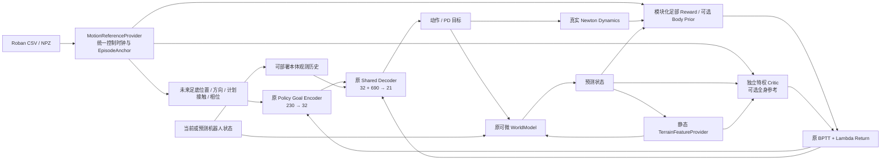

# Roban Foot-conditioned SuperMimic

任务来源：`TCRS+非对称supermimic训练.md`。实现日期：2026-11-14。

本实现扩展原 `supermimic/train.py`，保留 collection → replay → WM fit → imagined BPTT → 单 Critic lambda-return 更新。没有增加第二套 Trainer，没有修改 TCRS，没有启动正式长训练。默认机器人仍为 S54；只有 `--robot roban` 或 `--roban_config` 才切换 Roban。

## 1. 修改前后结构

原 S54 Motion Actor 将全身未来 Motion Goal 编码为 32D latent，再与观测历史送入 Decoder；Motion 观测还包含参考相对朝向/Root 反馈。Roban Actor 仅使用本体历史和足部目标。Critic 与 Actor 的特征、normalizer 和参数完全独立。



Critic 的全身参考是输入上下文。监督标签仍来自任务奖励的 lambda return，绝不将参考姿态直接作为 value 标签。训练时 Actor 梯度可经冻结参数的 WM、Reward 和 Critic 的状态输入回传；部署 forward 不调用 Critic、WM 或全身参考编码器。

## 2. 维度与数据协议

以下为默认 `hist=10, goal_frames=10, goal_dt=0.1s`，`J=21`。

| 项目 | 历史 S54 Motion | Roban |
|---|---:|---:|
| 动作 | 29 | 21 |
| 序列化状态 `p,quat,v,w,q,qd` | 71 | 55 |
| Actor 单帧观测 | 99 / Root-feedback 103 | 69 |
| Actor 历史 | 990 / 1030 | 690 |
| Actor Goal | 全身参考 730 | 足部 230 |
| Goal latent | 32 | 32 |
| Decoder 输入 | 1022 / 1062 | 722 |
| WM 不变状态特征 | 71 | 55 |
| `xi=[friction,joint offsets,COM offset]` | 33 | 25 |
| WM 输入，不含地形 | 133 | 101 |
| WM 输入，3×5×5 patch 地形 | 不适用 | 326 |
| WM 输出，原局部状态增量 | 70 | 54 |
| 单 Critic 输入 E0 | 不适用 | 310 |
| 单 Critic 输入 E1 / E2 | 不适用 | 880 |
| 单 Critic 输入 terrain smoke | 不适用 | 1105 |
| Critic 输出 | 1 | 1 |

Roban 本体观测顺序为 `[q-default_q (21), qd*0.1 (21), Rᵀω*0.25 (3), projected_gravity (3), previous_action (21)]`。不读参考 Root 朝向、真实线速度、地形、`xi` 或参考关节。部署时 planner/state estimator 应直接提供同协议的机器人局部足部目标，Actor 不要求 simulator 的 world pose 查询。关节实际状态属于本体输入；关节参考属于 Critic/辅助奖励输入。

每个 Foot Goal 采样点为 `[Left(p3,R6,contact,phase), Right(p3,R6,contact,phase), delta_t]`，共 23D；Rotation 6D 为矩阵前两列按行展开，沿用现有 `mat_to_6d`。位置为当前机器人 chest/root 原点下的 heading-aligned 坐标；方向只减当前 yaw，保留坡面倾角。所有 Tensor 为 float32，批维为环境/样本维；序列化 Contact 是 bool，送入 Actor 时转 float。

控制周期固定 0.02s。未来采样为 `f + stride*[1..K]`，`stride=goal_dt/0.02` 必须是正整数，默认未来 0.1…1.0s。`K*goal_dt` 为可配置 horizon。各 clip 单独重采样、计算速度，未来目标在本 clip 末帧截断，不跨 clip。

`EpisodeAnchor(start_frame, clip_id, rotation, translation)` 为 replay 保存不可变快照。Actor Goal、特权全身目标、Reward 和 Evaluation 调用同一个 Provider 的索引与刚体变换。真实/想象路径均检查 `f=start_frame+ep_step`。支撑目标固定在该次计划 touchdown 的足底位置，Actor 与 Reward/Evaluation 使用相同固定目标，避免把参考抖动变成滑脚命令。

## 3. Roban 模型、数据与控制审查

权威模型：`library/model/roban_s22_0901/xml/biped_s17_verified_handball_fixedhead.xml`；URDF 同名，位于 `urdf/`。模型 hash 和完整映射进入 checkpoint robot contract。

* 关节顺序由实际 MJCF hinge 遍历读取：腰 1、左腿 6、右腿 6、左臂 4、右臂 4。不是复制 S54 的 29D 索引。
* floating root 是胸部 `base_link`；腰/骨盆位于其下。头部固定，没有头部 action。
* 编译模型 `nq=28,nv=27,nu=21`；37 个非 world frame 包含固定相机 frame，不将它们全部假定为独立物理刚体。FK 保留完整树；仿真关节通过名称做双向一一映射。
* 左右脚为 `leg_l6_link/leg_r6_link`，索引由名称查找。现有碰撞圆柱和盒子给出足底中心 `[0.0475,0,-0.04]m`、heel x=-0.055m、toe x=0.15m、横向边界 ±0.04m。足底轴与 ankle link 平行，绝不把 ankle 原点直接当作足底。
* CSV 按表头读取 Root XYZ、Root XYZW、关节列；`Frame` 必须连续。内部 quaternion 为 WXYZ。诊断列缺失时只禁用对应质量门控，不用零诊断假装 IK 合格。要求 Root/关节数据有限且在模型关节范围内。
* NPZ v1 必需：`root_pos[T,3],root_quat[T,4],joint_pos[T,J],joint_names[J],fps,quaternion_order`。不允许 pickle。可选 `contact[T,2],contact_valid[T,2],swing_phase[T,2],quality[T]`。NPZ 必须显式确认 joint order、FPS、quat order。
* 速度在重采样后重新计算：root link 原点 world linear/angular velocity，关节 rad/s；不会把 MuJoCo 的局部 free-joint angular qvel 当作 world ω。独立 FK/雅可比测试核对位置、方向、线速度和角速度。
* Style100/SnapMoGen 的 50Hz 来源由现有 registry/生成日志声明；LAFAN/Kimodo 未确认 FPS 时拒绝读取，必须显式提供 `--reference_fps`。不擅自把未知 FPS 当 30/50。
* 当前 smoke 使用 `style100_roban_50hz/Neutral/Neutral_FW.csv`，6580 个控制帧，source SHA256 `c608e7cc69d9fb2bf34851d2e57974a9881709b3b9d6d76936277838ea7a781b`。它没有有效接触标签，IK 诊断列也未提供数据。

PD：腿/腰 Kp=200、手臂 Kp=80；Kd=`2*sqrt(Kp*armature)`。这些是明确的仿真假设，沿用项目控制约定，并非硬件实测值。Effort/armature 来自 MJCF，velocity limits 来自 URDF。动作经原 `[-20,20]` bound；目标为 `default_q + xi_joint_offset + 0.25*effort/Kp*action`。50Hz control、4 个 physics substeps（200Hz）、gravity -9.81m/s²，保留原 MJWarp solver。

独立生成 USD 于 `assets/roban/usd/`：仅去掉源 viewer 的 motor/sensor，驱动由 Isaac Lab actuator 提供；不改变关节、惯量、collision masks。Roban 自碰撞启用，地面是 `configs/roban/flat_ground.usda` 的本地 z=0 plane，避免默认远程地面资产下载。原模型只读，原 S54 USD/日志/checkpoint 均不修改。

## 4. Reward 的实际定义

令左右足位置误差平方为 `e_p`，方向 chordal error 为 `e_R=||R-R_ref||²_F/2`（小角度近似 rad²）；计划接触为 `c`、可信标签掩码为 `m`。

`reward = 0.02 * (Σ weight_i * term_i + body_prior_weight * prior)`。

| Term | 定义/尺度 | 默认权重 |
|---|---|---:|
| Swing position | mean `(1-c)*exp(-e_p/0.08²)` | 1 |
| Swing orientation | mean `(1-c)*exp(-e_R/0.3²)` | .25 |
| Stance stability | mean `c*exp(-||p-p_touchdown||²/0.08²)` | 1 |
| Contact schedule | mean `m*(1-(soft_contact-c)²)` | .25 |
| Touchdown | mean `valid_contact_rising_edge*exp(-e_p/0.08²)` | .5 |
| Upright | `exp(-(1-Rzz)/0.1)` | .5 |
| Survival | `1-soft_fall_probability` | .2 |
| Slip | `-mean(c*soft_contact*||v_foot_xy||²/0.2²)` | .1 |
| Joint limit | `-mean(relu(q-soft_hi)+relu(soft_lo-q))²`，rad² | 2 |
| Torque | `-mean(clipped_PD_torque/effort)²` | .01 |
| Action rate | `-mean(a-a_prev)²` | .05 |
| Non-foot ground collision | authored proxy bounding-sphere ground overlap² / .05² | 1 |
| Self collision | non-adjacent proxy inscribed-sphere overlap² / .05² | 1 |
| Auxiliary body prior | quality-gated bounded prior，见下 | E0/E1=0，E2=.03 |

所有权重/尺度在 `FootRewardConfig` 中，可用 `roban_reward_config` 覆盖。正项均≤1，惩罚采用关节/脚/碰撞对平均而非随模型维度无界叠加。总正奖励上界为 `.02*positive_sum`，用于日志归一化；保留参考型任务原有 bootstrap 逻辑。

`soft_contact` 使用最低足底角点相对地面的 clearance sigmoid 与 3D 足速衰减乘积，保留位置/速度梯度。它是可微几何接触代理，**不是实测接触力**。Torque 项是与 PD 目标一致的归一化代理，非 Newton 实测 torque。Ground collision 的包围球可能过于保守；self collision 的内接球可能漏检，二者为辅助惩罚。实际碰撞仍由完整 Newton collision proxies 约束，未为测试关闭。

缺少标签时，以足底 clearance + 足速 + 至少 3 帧持续时间估计计划 Contact/Phase；`contact_valid` 全 false，Contact Schedule/Touchdown 监督项为零，绝不将单一 ankle 高度阈值当真值。计划估计用于足部命令和 swing/stance 分配，需在正式实验前用可信接触数据验证。独立 Newton rollout 另采真实 solver contact forces。

Fall：chest 相对地面高度<.35m，或 `1-Rzz>.8` 时硬终止；soft termination 使用 .03m/.05 的 sigmoid 宽度，送入原 BPTT survival mask。Clip 末端和 episode timeout 保持原 Trainer 处理。

### Body Prior 与梯度

`prior = quality * (0.7*exp(-mean(upper_q-ref_q)²/0.5²) + 0.3*exp(-mean(waist_q-ref_q)²/0.5²))`。

上身只选实际 Roban `zarm_*` 关节，腰部由 `waist_*` 名称选择，不含下肢严格 joint mimic。可配置 Root orientation/height prior，默认均为 0；各 prior 子项权重之和必须≤1。

`body_prior_weight=0` 时跳过所有 prior 计算，奖励对全身关节参考的改变完全不变。E2 `.03` 的每步 prior 最大贡献 `.0006`；默认主要足部正项权重合计 3.0，每步上界 `.06`。单位测试同时验证贡献比例、非零上肢梯度及零下肢直接 prior 梯度；实际 BPTT 的纯足部 Actor 梯度通过 `roban_gradient_audit` 单独测量，排除 action cost 和 Critic bootstrap。受控 quality=1 NPZ 的关节状态梯度测试中，prior/foot 梯度范数比为 `0.00371`，prior/foot 奖励贡献比最大 `0.02328`；这是预测关节状态的局部梯度，不能替代真实数据上的 Actor 梯度标定。

CSV prior quality 仅在上身 position diagnostics <.1m、rotation diagnostics <.6rad 且均有限时通过；NPZ 可提供 `[0,1]` quality。无质量数据默认门控为零。当前真实 CSV 的 quality 全零，因此 **E2 smoke 验证配置/链路，但不构成有效 Body Prior 性能消融**；可信质量=1 的 NPZ 单元测试验证实际 prior 数值和梯度路径。`.03` 仍是后续实验候选，应在质量数据齐备后比较各项 Actor 梯度尺度。

## 5. Terrain-conditioned WM

统一 `TerrainFeatures(relative_heights,valid_mask,edge_features)`。每个字段为 `[B,3,P²]`，默认 P=5，patch width=.4m，anchor 是当前左右足底与 base，网格跟随当前 heading。flatten 按 heights / masks / edges 的顺序拼成 225D，送入原 WM `in_norm`；预测 target、out normalization、WM loss 和 replay termination mask 不变。

相对高度减去离真实足部最近的有效支撑面高度；两脚都没有有效投影时回退 base surface。无支撑区域 height 的存储值虽为零，但 valid=false，绝不当作实体零高度地面。柱顶 provider 接受 `[cx,cy,half_x,half_y,top_z]` 和显式可选 base plane。Stair/mesh adapter 接受世界 XY height grid、valid mask、origin 和 spacing。

WM 的 `inputs/step` 每次都调用 provider，位置来自该次真实/预测状态；没有缓存 rollout 起点地形，也不读未来目标或全身参考。当前 provider 全是静态地形，时间平移不改变查询；replay 的 `f/ep_step` 保留时间戳。移动表面尚未实现。

梯度：flat height 对 XY 导数正确为零；height map 使用 bilinear grid sampling，保留 XY 梯度；柱顶/支撑选择/validity 为分段离散选择，不伪造跨边缘梯度，edge signed distance 在分段内部可微。阶梯 height map 的 riser 处会被插值平滑，需要足够网格分辨率并与物理 mesh 核对。CPU 测试验证 ramp XY 梯度、pillar void mask 和预测状态平移后的重新查询。

Trainer 当前只开放匹配真实 flat scene 的 `terrain_provider=flat`。Pillar/heightmap 作为可运行的数据查询接口和测试实现存在；接入对应真实场景前不允许将它们冒充已验证的 Newton 地形任务。

## 6. 配置与生效位置

| 配置 | Actor | Critic body ref | Prior | WM terrain |
|---|---|---|---:|---|
| `configs/roban/E0.json` | foot | false | 0 | false |
| `configs/roban/E1.json` | foot | true | 0 | false |
| `configs/roban/E2.json` | foot | true | .03 | false |
| `configs/roban/terrain_smoke.json` | foot | true | 0 | flat |

这些 JSON 由 `roban_runtime.add_roban_args` 加载为原 argparse 的真实 defaults，CLI 可覆盖；未知键拒绝。`goal_mode=roban_foot` 对应需求文档的 `actor_goal_type=foot_trajectory`。`build_task` 构造 Provider/Goals/Reward/Critic context；`WorldModel(terrain_provider=...)` 接入地形；模型仍由 `train.py` 更新。E0/E1/E2 除两项消融字段外完全一致，包括 seed、数据、Actor 和训练预算。Critic 初始化隔离 RNG 消耗，避免输入宽度变化影响公共 reset/action-noise RNG。

默认配置刻意只有 **4 iterations**，包含 1 iteration WM-only；4 env、warmup 16 steps、WM window=4、BPTT horizon=4。不是正式训练预算或有效行走性能对比。

## 7. Checkpoint 与兼容性

Roban checkpoint schema=3，记录 robot、goal、task、physics、policy、data contracts，以及 pi/wm/critic、三套 Adam、RNG、iteration 和 sim steps。严格 resume 先比较 goal/task/critic/terrain/physical/data contracts，再严格加载 state dict 与优化器；形状不匹配不会用 `strict=False` 隐藏。

显式 `--init_weights` 支持同 Roban、同物理约定的兼容迁移，输出完整 tensor mapping。普通 flat WM → terrain WM 扩展首层，复制原列并将新增地形列置零；保留兼容 normalizer。跨 goal schema 不复制 Goal Encoder/GoalNorm；Decoder/本体语义或 WM 出现非预期不兼容时拒绝，要求明确 fresh run。Critic 与优化器在迁移时新建。

S54 flat checkpoint 属于另一机器人，明确拒绝导入 Roban；不能因为隐藏层形状相同就宣称动力学或关节语义兼容。旧 S54 工具、默认 CLI 和 checkpoint contract 保留。`RobotKinematics` 保留 `S54Kinematics` 别名。一个进程只选择一种 robot contract。

## 8. 文件变更

* 新增 `roban.py,robot_contract.py`：模型/控制/足底几何和显式机器人选择。
* 新增 `motion_reference.py,roban_task.py,roban_runtime.py`：统一数据/episode anchor、足部接口/奖励、原 Trainer 配置适配与显式兼容迁移。
* 新增 `terrain.py`：flat/pillar/heightmap provider 及梯度协议。
* 扩展 `kinematics,motion,mdp,goals,robot,env,transfer,networks,train`；保留已有 S54 逻辑，WM/BPTT/lambda-return 算法不重写。
* 新增四组配置、本地 plane、`prepare_roban_asset.py,roban_rollout.py,test_roban_foot.py,test_roban_smoke.py,run_roban.sh`。
* 生成独立 `assets/roban/usd/`、新 `logs/roban_*` 和报告；保留原库/日志/checkpoint。写回前备份现有修改文件并核对 SHA256，备份目录见交付报告。

## 9. 验证结果

最终测试在实际项目目录、RTX 4060 Laptop GPU 和已有 kit-less 镜像中运行，详细记录在 `reports/roban_arch_final_20261114/summary.json`。

* Roban CPU 单元测试：17/17 PASS；包含非零 WM 输出下的兼容迁移与 Adam 张量恢复核对。
* 历史 Foot/Root-feedback/control 回归：35/35 PASS。
* 四组各 4 iteration 原 Trainer 短训练：全部 PASS；每组 4 env、104 个真实 transition。下表为第4轮，所有值有限。

| 配置 | WM Loss | Critic Loss | Actor Grad Norm | Pure Foot Actor Grad Norm | 结果 |
|---|---:|---:|---:|---:|---|
| E0 | 2.88905 | 0.000554694 | 0.0369852 | 0.000886462 | PASS |
| E1 | 2.88902 | 0.00448301 | 0.0151272 | 0.000836567 | PASS |
| E2 | 2.88901 | 0.00448436 | 0.0151213 | 0.000836276 | PASS |
| terrain_smoke | 2.88372 | 0.00338517 | 0.0112295 | 0.00122209 | PASS |

* E1 严格恢复：iteration 4→6；Actor Adam step 3→5，权重继续更新，WM/Critic/Actor 优化器状态均正常载入。
* 独立 Newton rollout：请求100步，4个环境均在第75步按 fall 判据终止；保留 `n_failed=4`，不把它当作已经会行走。真实地面受力非零。
* 足底 FK 与 Newton 最大误差 `9.25328e-07m`；real/replay Reward 最大误差 `0.0`；初始 reset 后 Root/Joint 状态写入次数=0。
* E1 独立评估 normalized return `0.151377`、foot RMSE `0.215281m` 仅作未训练策略的诊断，不是性能验收阈值。
* 没有 NaN/Inf 或 shape mismatch；Python/shell syntax、`git diff --check` 与交付 hash 检查通过。

最终 checkpoint：`logs/roban_arch_final_20261114_E1/last.pt`。真实轨迹：`reports/roban_arch_final_20261114/newton/trajectory.npz`。原文件备份：`reports/roban_arch_refactor_20261114/before/`。CPU/回归日志和补充检查见同目录 `verification.json`。


已实现并运行的 CPU 验收包括：Actor shape/dtype/device、仅改全身参考时 Actor 输出不变、Critic 特权输入/梯度、Reward 范围与尺度、零 prior/质量门控、地形开关/batch/void/XY 梯度、WM loss/BPTT 有限性、索引/坐标/anchor、MuJoCo 全 body FK/速度、checkpoint/Adam/迁移、真实/replay 奖励一致性、消融配置实际解析、30→50Hz 和 clip 边界、独立 prior/foot 梯度、错误 episode clock 拒绝。

历史额外检查：S54 CPU FK/velocity/contact/WM/BPTT 诊断通过；最终 Foot/Root-feedback/control 回归运行 35 项全部通过。旧 MotionPrior 额外测试的 fixture manifest 仍指向迁移前 `.../supermimic_s54_main/data/...`，该 suite 在 setup 阶段被原路径失效阻塞；未改写历史 manifest 来伪造通过。

真实 Newton 评估使用只读固定 checkpoint、无 observation/action noise；只在初始 reset 写状态，此后对 Root/Joint state write 方法加禁止调用保护，仅通过 PD 动作步进。评估采集真实 solver contact forces，检查 foot FK 和 real/replay reward 一致性。架构 PASS 与策略是否会走路分开报告，跌倒次数保留。

## 10. 可执行命令

当前宿主机 `.venv` 缺少旧 importer，且 Isaac Lab API 与项目镜像不同；验证使用已有 `supermimic:latest` kit-less 镜像。无需重建或启动历史容器。以下在本项目根执行，Docker 账号需已有访问权限：

```bash
# 一次性生成独立 Roban USD，原 library 只读挂载
bash tools/run_roban.sh prepare

# CPU 单元测试（也可在有 torch/mujoco 的 Python 直接执行）
bash tools/run_roban.sh test

# 完整但严格有界的四配置 + resume + 独立 Newton smoke；prefix 必须新建
bash tools/run_roban.sh smoke --prefix roban_check_new

# 单组短训练；新目录保护已有结果
bash tools/run_roban.sh train --roban_config configs/roban/E1.json \
  --log_dir logs/roban_E1_new

# 从第4轮恢复到第6轮，保留模型/优化器；replay 按原设计重新填充
bash tools/run_roban.sh train --roban_config configs/roban/E1.json \
  --log_dir logs/roban_E1_new --resume logs/roban_E1_new/last.pt \
  --iterations 6 --recovery_wm_iters 0

# 独立 Newton evaluation，不设置参考姿态播放
bash tools/run_roban.sh evaluate --checkpoint logs/roban_E1_new/last.pt \
  --out reports/roban_E1_new_eval --num_envs 4 --steps 100
```

日志、checkpoint 和 report 输出均在宿主项目目录。Helper 使用当前用户 UID/GID，容器自动删除、禁网；不改变原实验容器。正式训练需另行选定数据/预算、可信接触与 IK quality，并调整 iteration/warmup/horizon；本任务未启动。

## 11. TCRS / Moving Pillars 后续接入

TCRS 输出最终 Roban joints/root 及计划 feet/contact/phase 时，按上述 NPZ 协议导出，显式携带 FPS、joint names、quat order、contact_valid 和 IK quality；左右足底 frame 必须与本模型几何一致。先用 FK/foot targets 对齐审查，再由同一个 Provider 生成 Actor/Critic/Reward/Evaluation 数据，不让各自另建时钟。

当前 NPZ 足部目标由 Roban FK 和 stance anchor 推导。若 TCRS 要保留独立规划足轨，应显式扩展 provider schema 增加规划 foot pose 并校验其与最终 IK 的误差/quality，不能把规划轨迹未经核对地当作 FK 真值。Actor 的 23D/sample 协议无需改变。

Pillars/Stairs 接入时，将真实 Newton collider/mesh 与相同 world XY provider 对齐。Moving Pillars 还需加入表面位姿/速度、查询时间、相对接触速度和 replay 时刻信息，并在 imagined rollout 用预测时刻查询。当前只提供静态协议与 flat 物理验证，没有实现动态柱子环境。
