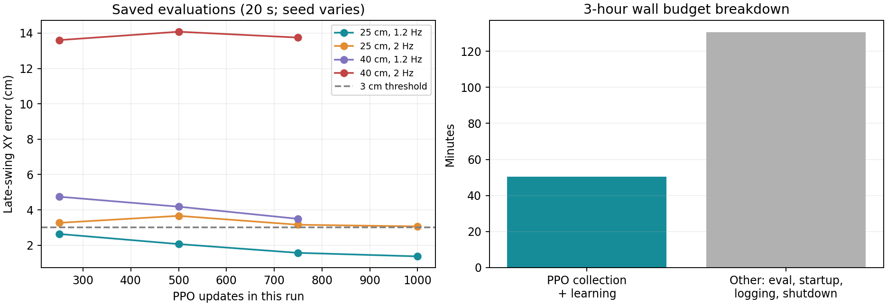

# 3小时hard_region结果：继续长训还是优化

建议保留当前checkpoint，先优化评估开销并做500–1000次PPO更新的受控消融，选出有效配置后再投入10小时。本次只分析日志、补测推理和生成报告，没有改训练配置/奖励，也没有启动训练。

## 实际完成了什么

实验 `logs/walk/2026-11-01_17-59-35_walk_hard_region_v2`：预算耗尽，1000次PPO更新、131072000条transition，全部处于bridge，没有晋级、没有阶段资格记录。bridge最低500次已满足，阻止晋级的是物理评估，而不是minimum_updates。

按1000行PPO指标累计 `Perf/collection_time + Perf/learning_time`：**3031.84秒（50.53分钟）**。监督器累计10862.46秒；其余7830.63秒（130.51分钟）是评估、启动、记录/等待和收尾等，不能全部严格归为评估，但PPO占比只有27.91%。此前每250次训练都触发多工况评估的设置过密，低估了完整诊断的开销，需要纠正。总墙钟3小时不能等同于3小时PPO优化。

## 物理指标

已有20秒、64环境评估（seed随评估轮次变化，不是严格同seed消融）：

| 命令 | 250次更新的末期XY | 750次更新的末期XY | 1000次更新已完成评估 |
|---|---:|---:|---:|
| 25cm / 1.2Hz | 2.64cm | 1.57cm | 1.37cm |
| 25cm / 2Hz | 3.27cm | 3.16cm | 3.06cm |
| 40cm / 1.2Hz | 4.74cm | 3.49cm | 预算内未完成 |
| 40cm / 2Hz | 13.61cm | 13.75cm | 预算内未完成 |

这说明部分任务仍在进步，不能据1000次更新宣称整个策略已收敛；但最大组合尚未出现明确的落脚精度改善。750更新的40cm/1.2Hz两脚成功率82.5%/77.6%，尚不满足两脚各80%及3cm门槛；最大组合仍为0%/0%。

本次补测最新 `training/00003_bridge/model_final.pt`，确定性推理、seed42、随机左右起步、16环境×500控制步=10秒仿真：

| 命令 | 无跌倒比例 | 左/右半周期成功率 | 末期XY | 实际/名义前进速度 | 归一化帧分数 |
|---|---:|---:|---:|---:|---:|
| 30cm / 1.5Hz | 100% | 84.6% / 86.5% | 2.749cm | 0.857 / 0.900m/s | 0.884 |
| 40cm / 2Hz | 100% | 0% / 0% | 13.219cm | 1.030 / 1.600m/s | 0.608 |

两次reward和phase对齐误差均0，terminated=0、truncated=16。短测说明最新模型保持稳定但最大组合落脚不准，不是长期稳健性证明；未把10秒补测与20秒历史评估混作同条件结果。最大组合速度折算步长约 `1.03/(2×2)=0.257m`，提示前向步长不足；该估算依赖稳态等时步态，不能替代有符号足端XY测量。

精确命令见 `commands.json`，补测结果/分项见 `latest_30cm_1p5hz.json`、`latest_40cm_2hz.json`，逐帧见对应JSONL。

## 奖励和训练信号

1. **总分与精确落点仍有差距。** 最大组最后50次更新的平均归一化帧分数约0.602，最新确定性补测0.608，但两脚成功率均0。它仍能通过抬脚、方向和姿态领取奖励。解析反例：在有效支撑、无惩罚、其它正项理想而XY两项完全0分时，按当前逐相位参考上界平均的帧分数仍约0.579。这是公式性质，不是某个策略的实测结果，也不单独证明存在无法逃逸的局部最优。

2. **摆动末期XY的相对优先级值得小幅消融。** 当前XY总权重4，内部左右/摆支平均，摆动部分再乘u²。单纯增加tracking_xy_w会同时强化支撑脚目标，不能把它等同于只鼓励摆动脚迈远。优先考虑把摆动末期XY作为独立可调权重，在保持防跳/防滑门控的条件下比较物理改善。

3. **大误差处有奖励衰减。** 核为exp(−100e²)：e=3/10/14/20/30cm时分别约0.914/0.368/0.141/0.0183/0.000123。大误差的接近信号较弱，可对宽核接近项与窄核精度项做消融；14cm处信号并非完全消失，不能把所有问题归为“梯度为零”。PPO也不是直接对物理足端误差反向求导。

4. **数据分布仍是拆开学大步和高频。** bridge有35%大步中频、40%小步高频，联合最大组合只有5%；尚未进入70%联合30–35cm/1.5–1.8Hz的frontier。更多更新可能继续有效，但应集中可达难度边界，而不是根据最大工况0成功就直接大比例增加最难采样或跳过门槛。

## 控制与探索也要检查

当前动作经[-1,1]裁剪后，以alpha=0.2在50Hz下滤波，再乘关节scale变成PD目标。滤波等效时间常数约90ms，而2Hz单侧摆动只有250ms，存在明显响应延迟的可能。策略可学习补偿，是否构成瓶颈需要同checkpoint A/B，而非直接认定滤波必须减弱。

训练末50次更新：双腿部分roll关节动作裁剪约95–99%；髋pitch的策略步末PD估计达到限幅的比例左约20%、右约34%。这是原始动作裁剪与末帧估计，不是500Hz实际峰值力矩，更不能据此宣称到达机器人硬件极限。建议测目标/实际关节幅值、相位延迟、足端有符号XY和分工况裁剪，再决定是否调整滤波/scale；不同时放大PD、力矩和动作范围。

Policy/mean_std约3.24，但逐关节差异很大：髋pitch约0.062/0.096，膝约0.025/0.065；腰、部分roll和双臂更大。原始std不是关节角也不是力矩，均值不能代表腿部有效探索。完整值见 `joint_std.json`。直接改init_std不会覆盖完整恢复后已学到的std参数，应另设明确的噪声限制/熵系数实验并保存配置。

动作边界和噪声参数属于应单独检查的实现选择；[Andrychowicz等的on-policy实现研究](https://arxiv.org/html/2006.05990v1#S3.SS2)也讨论了其影响，但不能把其MuJoCo结论直接当作S54的验证结果。

## 推荐顺序

1. 调整评估调度：快速评估用16–32环境、300–500步，长时间训练每750–1000次更新或阶段候选晋级时评估；完整64环境/1000步和最终60秒检查低频执行。保留不变的评估门槛。优先优化完整诊断的重复计算，避免大部分预算用于检查。
2. 保留当前模型做高频控制响应短测；这是决定是否需要控制改动的依据。
3. 同checkpoint、同命令分布、同更新数做A/B：A保持v2；B只改变摆动末期XY的相对权重；宽/窄核或滤波/探索另作后续单因素版本。先500–1000次更新（约25–50分钟纯PPO，另加评估），而非直接10小时。
4. 验收30cm/1.5Hz、35cm/1.5–1.8Hz、40cm/1.2Hz和40cm/2Hz；单列左右起步、首步与后续、末期XY分位数、成功率、实际速度、滑动/跳动和存活。选出物理指标改善且基础任务不退化的配置再长训。

这些是待验证方案，本次未应用任何奖励或控制改动。记录来自原日志的摘要、模型hash和评估历史见 `log_summary.json`；公式核值与滤波估算见 `reward_reference_analysis.json`。保留本轮正向进展，不需要因最大角点尚不准就回滚到旧实验。
