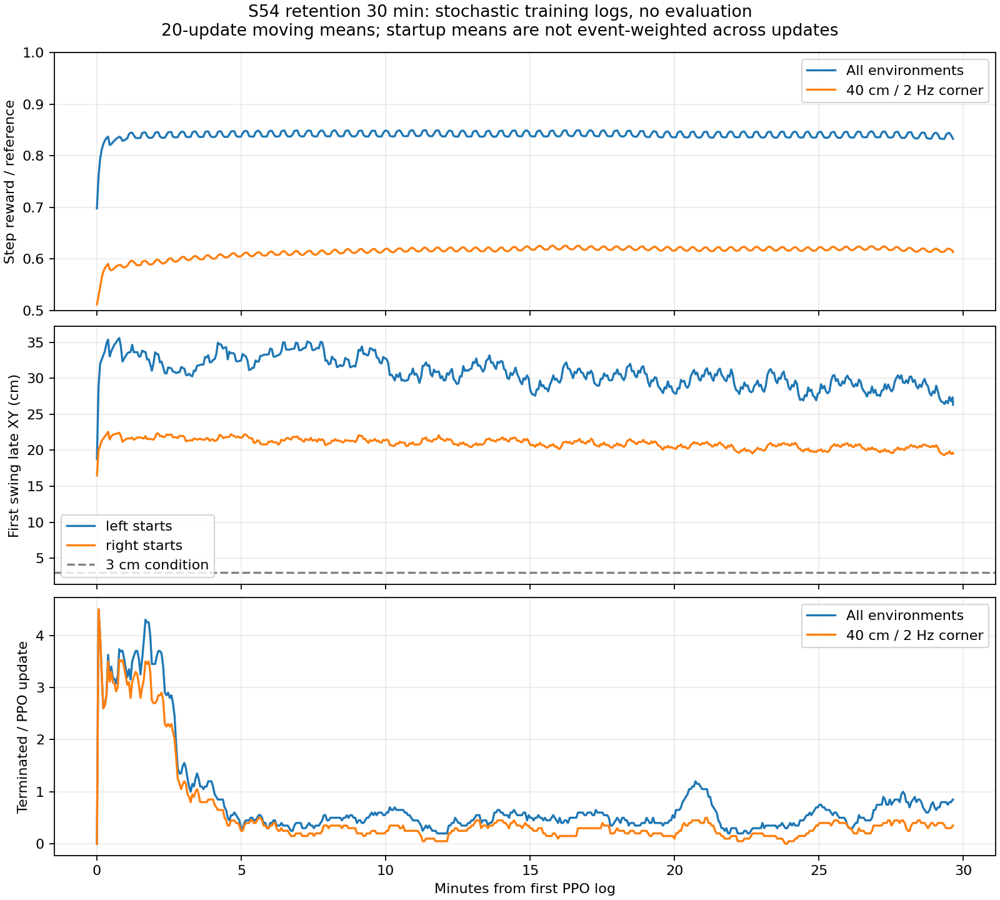

# 30分钟实时监督结论

**建议先针对首步做单项调整，暂不直接续训10小时。** 主体奖励、15格覆盖和保守PPO配置继续保留；本轮较好地保持了稳定性，但角点回报后半程趋平，右脚先迈的首步成功指标始终为0，目标落点精度仍需单独验证。

实验：`logs/walk/2026-11-02_00-32-11_walk_retention_30m`。
监督时段：2026-11-02 **00:34:16—01:04:16，Asia/Shanghai**。每5分钟读取一次已有日志；首次基线实际采样于00:37:01，其后检查实际时刻见下表及`check_*.json`。全程不运行eval、不改训练参数、不重启或延长训练。

## 每5分钟检查

表内均值仅来自该检查间隔新增的PPO更新。初始80更新的基线单列；第5分钟检查后新增40更新。训练早于监督窗口约2分钟开始，因此第30分钟检查时已正常结束，本窗口只有53次更新。

| 监督分钟 / 本地时间 | 累计 / 本窗更新 | terminated / truncated | 角点每步归一化奖励 | 首步XY 左 / 右（cm） | 右侧首步成功指标 |
|---|---:|---:|---:|---:|---:|
| 基线 / 00:37:01 | 80 / 80 | 175 / 20332 | 0.5968 | 32.7 / 21.7 | 0% |
| 5 / 00:39:16 | 120 / 40 | 16 / 10229 | 0.6098 | 33.1 / 21.4 | 0% |
| 10 / 00:44:16 | 208 / 88 | 41 / 22520 | 0.6162 | 31.9 / 21.3 | 0% |
| 15 / 00:49:16 | 296 / 88 | 46 / 22581 | 0.6202 | 30.7 / 21.1 | 0% |
| 20 / 00:54:16 | 385 / 89 | 47 / 24425 | 0.6189 | 30.0 / 20.7 | 0% |
| 25 / 00:59:16 | 473 / 88 | 40 / 22532 | 0.6201 | 28.7 / 20.3 | 0% |
| 30 / 01:04:16 | 526 / 53 | 44 / 14278 | 0.6169 | 28.3 / 20.1 | 0% |

首步XY和成功指标是训练日志的**按更新均值**，事件数未同时导出，不能当成精确的全体首步事件加权统计；训练包含随机动作，不能与此前确定性eval直接排名。右侧成功指标在所有记录中都为0，说明严格的首步综合条件始终未满足，并不等于右脚从未移动。

## 训练是否正常

- 总计 **526次更新、68,943,872条已记录PPO transition**；总墙钟约30.07分钟，其中PPO采样与学习约28.35分钟（约94.3%）。状态`budget_exhausted`，正常按预算收尾。
- 全程terminated **409**，truncated **136897**，分别统计。多数episode正常超时；这不能替代分区确定性存活率，两个终止标记若重叠也不能算成两个独立episode。
- 526次已记录rollout均15/15格完整，缺样次数0，每格至少2624条transition/rollout；基础组和固定角点也核对配额。没有eval目录，`evaluation_enabled=false`。
- 无非有限数日志，value loss没有持续发散：第10/15/20/25/30分钟窗口均值约0.029/0.031/0.033/0.030/0.050。最后窗口有所升高，需要继续观察，尚不足以认定发散。
- SwanLab终端明确显示`Upload complete: 16243 records`；[实验曲线](https://swanlab.cn/@yagami_light/S54-Locomotion/runs/9lw3jjx6)。监督器、仿真和上传均已结束。

最后模型：

```text
/mnt/sage_data/workspace/KUAVO_S54_Newton/logs/walk/2026-11-02_00-32-11_walk_retention_30m/training/00000_retention/model_interrupted.pt
```

已在CPU确认checkpoint可读取，保存iteration=27324；SHA-256：`7f0864fd9e1713395efbeaf965b2b282b5b8394f02ea042c650c417fa39ccde8`。文件名`model_interrupted.pt`来自墙钟截止信号后的保存，本次不表示训练失败。原始500更新候选和本轮`model_27000.pt`、`model_27250.pt`均保留；本轮未评选“最佳模型”。

## 如何解读效果

**能力保持较好，精度改进有限。** 第5与第30分钟窗口，全局每步归一化奖励约0.843→0.838，角点约0.610→0.617；角点在后半程约0.62附近波动。第20分钟多数普通格相对初始基线变化不到0.6个百分点，没有训练日志层面的明显能力遗忘。初始基线角点0.597包含启动过渡期，不应把到最终0.617的全部变化都归因于优化后的权重。

**起步仍是主要短板。** 左/右首步XY从第5分钟约33.1/21.4cm，缓慢降至28.3/20.1cm；右侧严格成功指标一直为0，左侧末窗按更新均值约6.3%。源500更新模型的既有角点确定性结果也是左右首步成功率0，说明这是延续的短板。由于本轮训练命令混合且含探索，不能把本轮首步均值与旧固定角点eval直接比较。

训练日志没有直接导出各格的连续步行末段XY误差，故**无法确认本轮40cm/2Hz实际落点误差已缩小**。归一化奖励还包含抬脚、姿态、朝向及惩罚，不能倒推出厘米误差。

回报低谷多相隔7–8次更新，与10s episode / (64×0.02s)≈7.81更新相符。前296更新中，timeout标记与下一更新回报相关系数约−0.70，支持同步timeout后起步造成周期性低谷的解释。这是日志推断，不能排除其他优化因素。也应区分每步归一化奖励与episode回报：全程episode结束标记近似加权的normalized_return约0.844；简单平均PPO更新会放大只有少数失败episode结束的窗口。二者都不能作为物理行走成功率。



图中为20更新移动均值；首步曲线按更新平均，非精确事件加权。终止曲线为每PPO更新的标记次数，全局包含角点，两个曲线不能相加。

## 下一轮建议

1. **保留主体奖励和安全约束。** 支撑脚滑动/跳动、身体姿态、朝向奖励、普通摆动XY权重、10s连续episode、15格采样、10%固定角点和LR=2e-5均保持。
2. **仅做首步单项消融。** 从同一checkpoint分别比较当前配置与`first_swing_xy_multiplier: 1.5→2.0`，各做约30分钟短实验，先不加大全部tracking权重、不扩大命令范围。该值是温和的待验证建议，并非已证实的最优参数。首步只占10秒episode的一小部分，提高它的相对权重有明确目的，但仍须验证是否牺牲支撑或连续行走。
3. **补齐本地首步测量。** 导出每侧首步样本数、各格首步成功数/末段XY，以及分组连续步行XY，避免按更新平均掩盖样本构成变化；SwanLab继续保留精简聚合曲线。
4. 消融后按需**单独短测**中档与角点、两种起步脚，确认“首步XY下降、成功率增加，同时角点存活及普通工况不退步”再扩到1–3小时。若首步加权仍无改善，转向首步落点/起步节奏课程，而非连续叠加更多奖励。当前不具备直接承诺10小时长训会突破精度平台的证据。

以上为建议，**未修改奖励或启动下一轮**。新增的`scripts/monitor_training.py`只读已有日志；详细原始检查在本目录`checks.jsonl`、`check_*.json`，总统计与checkpoint哈希在`summary.json`，噪声诊断在`noise_checkpoint27000.json`。
