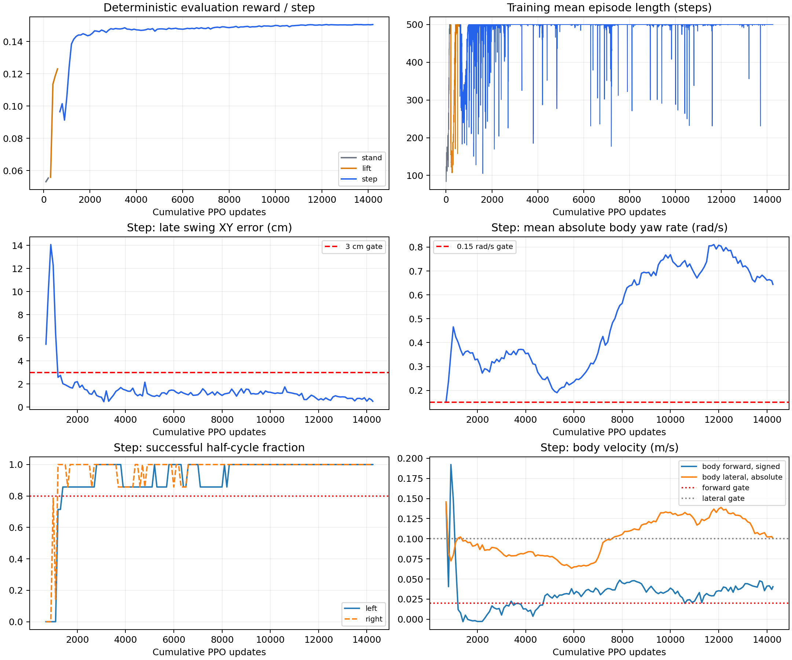
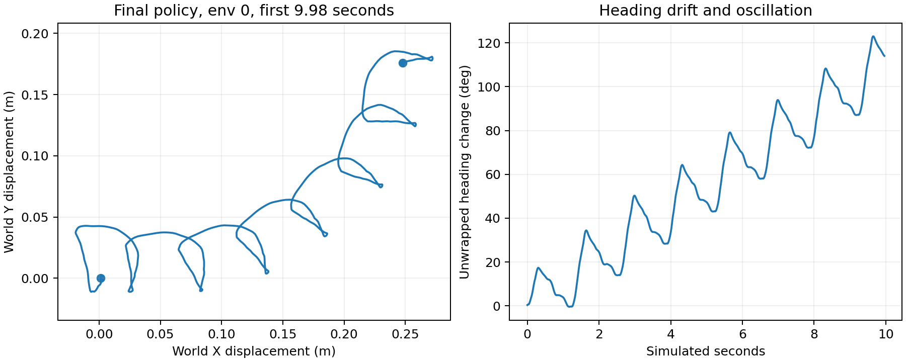

# S54 本轮训练效果与指标解释

结论：默认平地、默认初始姿态下，站立和原地交替抬脚已通过当前评估门槛；3 cm 足印任务已形成稳定、连续的交替落脚行为，但尚未获得合格的直行策略。主要问题是偏航，伴随较大的侧向往复运动和大量动作限幅。未进入 6 cm 的 `walk` 阶段，更未验证速度指令、停止、转向或扰动恢复。

## 数据范围与结束原因

- 归档后的历史目录：`.log_archive/2026-10-29_before_cleanup/logs/long_runs/2026-10-29_01-25-48_s54_4060`，SwanLab run `760np3wp`。
- `state.json`：`budget_exhausted`，到达本次 12 小时预算，并非崩溃；累计 14249 次 PPO 更新、1,867,644,928 个环境转移样本。
- 2048 环境，rollout 64；每次更新 131072 个样本。站立 200 次更新，抬脚 400 次，小步 13649 次。
- 共保存 142 次完整独立评估：stand 2、lift 4、step 136。最后 49 次更新后的保存文件名为 `model_interrupted.pt`，表示预算停止时保存，文件已成功加载并补测。
- checkpoint 中 `iter=13648` 是 step 阶段从 0 开始的更新索引；跨阶段只迁移 actor，阶段计数重置。与累计 14249 没有矛盾。
- 用户粘贴的 Eval/step 数据对应累计 14200 次更新；Train/step 数据对应 14249 次更新。二者不是同一次 policy。

## 评估结论

| 项目 | stand，更新 200 | lift，更新 600 | 最后完整 step，更新 14200 | 最终 step，更新 14249（补测） |
|---|---:|---:|---:|---:|
| 每步平均 reward | 0.055335 | 0.122998 | 0.150483 | 0.150509 |
| survival_fraction | 1 | 1 | 1 | 1 |
| terminated / truncated | 0 / 128 | 0 / 128 | 0 / 128 | 0 / 128 |
| 左 / 右成功半周期 | 0 / 0（不用于站立门槛） | 0.8571 / 1 | 1 / 1 | 1 / 1 |
| 连续至少 8 个成功半周期环境比例 | 0（不用于站立门槛） | 1 | 1 | 1 |
| 摆动末期 XY 误差 | 20.00 mm | 13.37 mm | 6.23 mm | 5.00 mm |
| swing_air_ratio | 0 | 0.56 | 0.60 | 0.60 |
| touchdown_ratio | 0 | 0.1569 | 0.1939 | 0.1940 |
| body 前向速度，带符号 | -0.00579 m/s | -0.00198 m/s | 0.03704 m/s | 0.04044 m/s |
| body 侧向速度绝对值均值 | 0.07560 m/s | 0.07557 m/s | 0.10275 m/s | 0.10052 m/s |
| body yaw 角速度绝对值均值 | 0.01313 rad/s | 0.10794 rad/s | 0.65903 rad/s | 0.64376 rad/s |
| mean_upright | 0.99905 | 0.99770 | 0.99927 | 0.99926 |
| 最低有效 root height | 0.9623 m | 0.9550 m | 0.9311 m | 0.9312 m |
| 当前课程门槛 | 通过 | 通过 | 未通过 | 未通过 |

每次评估为确定性 policy、64 环境 × 1000 步。每步 0.02 s，但 episode 在 10 s 重置，所以这是每环境两段 10 s，不能宣称已经连续无重置走满 20 s。初始姿态没有随机化；64 个复制环境也不等于 64 次独立随机扰动测试。

站立在更新 100 / 200 连续通过，抬脚在 500 / 600 连续通过。全部 136 次 step 评估都未通过 yaw ≤0.15 rad/s；其中 70 次还超出侧向速度门槛。最后补测仍未通过 yaw 和侧向门槛。yaw 0.64376 rad/s 约为 36.88°/s，为门槛的 4.29 倍。

相较训练初期，训练 episode 均长从约 123 步提升至 500 步；step 最近 100 次更新平均 episode 长度 500、每步 reward 0.150015、value loss 0.001741。这说明 policy 已稳定完成当前奖励要求，但目标函数未充分约束直行。



## 补充轨迹与动作诊断

平均绝对 yaw 角速度本身不能区分左右摆动和净转向，所以另做了 8 环境、1000 步的只读轨迹诊断。以下为 env 0 第一段 episode，约 9.98 s 的有效状态；8 环境诊断与 64 环境主评估是两次仿真，数值不应逐点混用。

- 净世界坐标位移约 `(0.248, 0.176) m`，实际 XY 路径长约 1.056 m。
- 净 heading 改变约 114.1°，heading 极差约 123.4°；累计绝对转角约 425.0°。说明既有方向漂移，也有较强的来回偏航，不能描述为正常的小幅左右摆动，也不能简化成匀速单向转圈。
- 确定性 actor 原始输出中约 62.73% 的动作分量超出 [-1,1] 并被裁剪。腿部约 29.57%，腰约 94.31%，手臂约 88.89%。这不是 62.73% 的关节超过机械限位。
- 实际关节目标另外受软限位约束，诊断约 5.00% 目标分量发生软限位裁剪；该计数含重置帧，只用于定位动作冗余，不等同于碰撞或损坏。
- checkpoint 的腿部 Gaussian std 平均约 0.111，腰及手臂平均约 0.609；全关节平均 0.3877 掩盖了这种差异。确定性评估使用分布均值，不额外采样这些噪声。



## 为什么高 reward 没有得到直行

1. `rewards.py` 奖励足端 XY、抬脚高度、摆动腾空、支撑和直立，没有前向速度指令跟踪、世界 heading 保持或 yaw 角速度惩罚。upright 只关心倾斜，绕竖直方向转动仍可接近 1。
2. 新足印沿当前支撑脚 yaw 生成，支撑脚朝向变化时，后续目标方向也会跟着转。当前奖励没有单独约束足部 yaw，足印任务因此允许绕弯完成。
3. action_rate 只惩罚动作变化，且经过 alpha=0.2 平滑、27 关节平均；它不是动作幅值、能耗或力矩惩罚。持续大幅 / 饱和动作仍可能只付出很小的代价。
4. 当前 step 奖励的理想连续相位参考上界约 0.15135/步，最终评估约 0.15051，已经很接近。继续使用相同奖励长训，未必会主动修复没有被奖励约束的 heading。

因此下一轮优先测试固定参考 heading / 指令方向、yaw rate 及速度跟踪信号，并检查腿与上肢的动作分布及幅值正则化。先做短消融和独立轨迹评估，不建议仅放宽门槛或原样延长训练。本次没有修改 reward、action scale、PD、Goal Sampler 或 checkpoint。

## 回放命令

在项目根目录执行；自动恢复保存的 task 配置，不要加 `--stage walk` 强行覆盖训练任务。

```bash
cd /mnt/sage_data/workspace/KUAVO_S54_Newton
RUN=.log_archive/2026-10-29_before_cleanup/logs/long_runs/2026-10-29_01-25-48_s54_4060
CKPT="$RUN/training/00142_step/model_interrupted.pt"

PYTHONPATH="$PWD" uv run \
  --project /mnt/sage_data/workspace/IsaacLab_3_0 \
  --no-sync isaaclab -p scripts/play.py \
  --checkpoint "$CKPT" \
  --num_envs 16 --steps 1000 --viz newton_gl
```

前 8 个环境运行 policy，后 8 个是零动作对照；看到部分机器人站着不动是脚本设计。play 输出 `Checkpoint evaluation PASSED` 仅代表执行和数值检查完成，不代表通过 locomotion 门槛。

可替换 CKPT 后重跑上面的 uv 命令：

```bash
# 已通过原地交替抬脚门槛的模型。
CKPT="$RUN/training/00005_lift/model_final.pt"

# 较接近直行的历史候选：累计 5300 更新，全部门槛仅 yaw 未通过。
# yaw=0.19048 rad/s、vx=0.02680 m/s、XY误差10.18mm。
# 它比最终模型 yaw 小，但也未达到正式直行标准。
CKPT="$RUN/training/00052_step/model_final.pt"
```

## Eval 指标的物理意义与理论范围

下表使用字段末段名称。`Eval/step/...` 等前缀表示评估的课程。JSON 最外层的 `step=14200` 是累计 PPO 更新数；`Eval/.../steps=1000` 才是该次每环境的仿真控制步数。Hardware 的 step 则是采样序号。用户粘贴的 `min` / `max` 是本次曲线历史观测极值，不是指标的理论边界或最佳目标。

| 字段 | 物理 / 统计意义 | 范围、理想值与注意事项 |
|---|---|---|
| action_rms | actor 输出经 [-1,1] 裁剪后的归一化动作 RMS | [0,1]；没有“越小越好”的统一目标，不是 rad 或力矩 |
| filtered_action_rms | alpha=0.2 平滑后动作 RMS | [0,1]；对应关节 offset = 各关节 scale × 平滑动作，不能用一个 RMS 直接代表所有关节角 |
| survival_fraction | 整段评估从未发生 terminated 的环境比例，正常 timeout 不扣分 | [0,1]，理想 1，门槛≥0.95 |
| terminated | 全环境累计跌倒终止次数，同一环境可多次 | 非负整数，理想 0；不是跌倒环境百分比 |
| truncated | 全环境累计正常超时次数 | 非负整数；本次无跌倒时应为 64×2=128，是正常重置，不是失败 |
| half_cycle_success_left/right | 已完成的对应摆动半周期中，真正抬脚、晚期接触到位且摆动中支撑不断的比例 | [0,1]，理想 1，门槛每侧≥0.8；抬脚高度须超过 max(1cm,0.6×目标高度)，接触 Fz>20N，末期 XY<3cm |
| consecutive_8_success_fraction | 曾达到连续≥8个成功半周期、并且全程无跌倒的环境比例 | [0,1]，理想1；8半周期=4个左右完整周期，约5.33s。并非整段每个半周期均成功；最终模型 best_consecutive 均为14 |
| swing_air_ratio | reward 中 swing_air>0 的控制帧比例 | 一般[0,1]；本课程仅在半周期0.2<u<0.8计分，完整均匀周期理想约0.60，不是1。还要求支撑脚接触；stand 权重为0故恒0 |
| touchdown_ratio | 晚期接触、XY<5cm且本半周期曾离地的奖励帧比例 | 一般[0,1]；完整均匀周期理想约0.20，不是1。它是帧比例，不是每次触地的成功率 |
| late_xy_error_m | u≥0.8且未重置的控制帧上，摆动脚到当前目标 XY 欧氏距离的平均 | ≥0，理想0，门槛≤0.03m；无有效样本时代码分母保护可能给0，不能脱离半周期样本和成功率使用 |
| mean_forward_velocity | body坐标根部 vx 的带符号均值 | 没有固定通用最值；越大不一定越好。3cm足印、0.75Hz完整步态的几何参考约2×0.75×0.03=0.045m/s，并非显式速度命令 |
| mean_abs_lateral_velocity | body坐标根部 vy 绝对值的平均 | ≥0；0表示没有侧向运动，但真实交替支撑可能需要侧向摆动。它不等于净侧漂，当前门槛≤0.10m/s |
| mean_abs_yaw_rate | body坐标根部 wz 绝对值的平均 | ≥0，直行理想接近0，门槛≤0.15rad/s；不是净转向角，需结合累计 heading |
| mean_upright | 平均 -projected_gravity_b.z，约为躯干倾角cos | [-1,1]，理想1；不约束水平 heading。奖励内部还会截到[0,1] |
| mean_root_height | 根部相对地面的平均高度 | 单位m，无固定越大越好的最值；默认站姿约0.969m，行走时自然变化 |
| minimum_valid_root_height | 排除 autoreset 帧后的最低根部高度 | 单位m，门槛≥0.85m；不等于足端 clearance。环境真正跌倒阈值还更低，为0.55m |
| mean_reward | 对全部环境、全部控制帧平均的每步 reward | 受权重、dt、相位和阶段影响，不存在通用“满分1”；不同课程不能直接横比 |
| passed | 本次该阶段的所有门槛是否同时满足 | 0或1；要连续两次为1才晋级；step最终仍为0 |
| max_reward_alignment_error | 用物理结果和旧 phase / goal 重算 reward，与环境返回值的最大差 | ≥0，理想0，测试容差1e-5；证明时间对齐，不证明走得正确 |
| distinct_log_objects | 每步 log 字典是否分别创建的调试指标 | 本次1000步应为1000；不是行为成功率 |
| num_envs / steps | 此次评估规模 | 本次64 / 1000；不是性能分数 |
| gpu_memory_used_bytes / total_bytes | 评估结束时 CUDA 查询的显存占用 / 总量 | bytes；不是峰值。64环境评估显存不能与2048环境训练占用直接比较，不同接口统计口径也可能不同 |

## Reward 分项：已经包含权重和 dt

`Reward/*` 与 Eval JSON 的 `reward_components` 都是加权并乘以 dt=0.02 后的每步贡献。以下为 step 阶段，令 u 为半周期进度，h(u)=sin(pi u)。所有单项理想值相加只是忽略机械约束、以连续均匀相位计算的参考；实际离散采样、reset 和64步训练窗口会造成差异，不能把参考值当成每个训练点的硬上界。

| 字段 | 计算含义 | 单帧取值边界 | 连续完整周期理想均值参考 | 最终评估 |
|---|---|---:|---:|---:|
| swing_xy | 0.02×4u²×exp(-100×XY误差²)，越接近摆动结束越重视落点 | [0,0.08] | 0.026667 | 0.026582 |
| stance_xy | 支撑脚保持在缓存世界目标附近 | [0,0.01] | 0.010000 | 0.009867 |
| clearance | 跟踪2cm正弦高度，相对地面站立基准归一化，支撑脚须接触 | [-0.08,0.08] | 约0.038684 | 0.038316 |
| swing_air | 半周期中段摆动脚Fz≤20N，支撑脚接触 | [0,0.06] | 0.036000 | 0.036000 |
| stance_contact | 支撑脚Fz>20N | [0,0.01] | 0.010000 | 0.010000 |
| touchdown | 半周期末20%时，摆动脚接触、XY<5cm且曾离地 | [0,0.04] | 0.008000 | 0.007760 |
| upright | 躯干直立cos截到[0,1] | [0,0.01] | 0.010000 | 0.009993 |
| action_rate | -0.02×0.05×mean((平滑动作变化)²) | 当前alpha下保守边界[-0.00016,0] | 最优0 | -0.00000823 |
| unloading | 中段摆动脚卸载，clip(1-Fz/330N,0,1)，支撑脚须接触 | [0,0.02] | 0.012000 | 0.012000 |

action_rate 边界来自原动作和旧平滑动作在[-1,1]，单步平滑动作变化绝对值≤2alpha=0.4；不代表整个周期能持续达到这个负边界。clearance 参考考虑了归一化分母的0.05下限，所以不是简单的0.08×1/2=0.04。

相同理想参考计算：stand约0.05667/步，lift约0.13135/步，step约0.15135/步。500步完整episode的未折扣 reward 参考分别约28.33、65.68、75.68；真实任务仍受动力学约束。最终 step 的 episode reward 约75，说明奖励已经接近其自身参考上限，不能据此宣称实现直行。

## PPO / Train / Perf 指标

| 字段 | 意义 | 理论范围 / 理想判断 |
|---|---|---|
| Train/mean_reward | 最近100个已结束episode的未折扣累计reward均值 | 非通用固定范围；会随存活长度和阶段权重改变。不是单步mean_reward，两个量也不必精确相乘等于episode均值 |
| Train/mean_episode_length | 最近100个已结束episode的控制步数均值 | 当前上限500步=10s；接近500且terminated少，说明存活提高 |
| Termination/terminated_fraction | rollout各控制帧上，terminated环境比例的均值 | [0,1]，理想0；不是每个episode的失败概率 |
| Termination/truncated_fraction | rollout各控制帧上，正常超时环境比例的均值 | [0,1]；长时间稳定运行参考约1/500=0.002，但2048环境若同步结束，64步窗口可为0或出现尖峰，不应强求每点固定0.002 |
| Loss/value | critic预测与GAE回报目标的平方误差，包含clipped value loss | ≥0，0是预测误差最小值；critic准确不等于行为符合直行目标 |
| Loss/surrogate | PPO用于最小化的裁剪策略代理损失，代码包含负号 | 可正可负，没有通用固定最优数值；不能用“降到0”判断学会，也不能仅凭正值宣称训练崩溃 |
| Loss/entropy | 27维独立Gaussian的微分熵，字段虽在Loss组，实际记录熵本身 | 可为负，负值不是报错。H=sum(log sigma_i)+27/2×log(2pi e)，不是离散概率熵，也不是裁剪 / 平滑后动作的熵 |
| Policy/mean_std | 27关节Gaussian标准差的算术均值，归一化动作单位 | 具体实现sigma被截在[1e-6,1e6]，没有行为意义上的统一最优值；全关节均值可能掩盖腿与上肢差异 |
| Loss/learning_rate | 当前优化器学习率 | 配置为1e-4 fixed；水平线正常，不是学习停了 |
| Perf/collection_time | 一次更新收集2048×64样本的用时 | 秒，越低吞吐越高；不是步态质量 |
| Perf/learning_time | 一次PPO优化更新的用时 | 秒，无通用理论最优值 |
| Perf/total_fps | N_env×rollout / (collection_time+learning_time) | samples/s；最终约50194。不是单环境的控制频率，物理 / 控制频率仍为500 / 50Hz |

最后checkpoint的std范围约0.0140–1.0738，几何均值约0.2249；因此平均std=0.3877与Gaussian熵约-1.98可以同时成立。训练日志熵是minibatch过程平均，checkpoint是最后参数，两者略有差异也正常。连续Gaussian在不截sigma时微分熵无有限上下界；在本实现默认sigma范围下，27维数学边界约[-334.71,411.33]，这些极端不是推荐训练目标。

## Hardware 与 Progress

| 字段 | 意义 / 单位 | 理论最值的解释 |
|---|---|---|
| Hardware/power_w | NVIDIA查询的瞬时功耗，W | 受GPU和供电限制，不是越高policy越好，无跨机器统一最值 |
| Hardware/temperature_c | GPU温度，摄氏度 | 需结合设备限制，无训练效果最优分数 |
| Hardware/used_mib | 当前GPU已用显存，MiB | 0到设备可用总量；不是峰值，也不应追求占满才算训练有效 |
| Hardware/total_mib | NVIDIA报告的显存容量，本机8188MiB | 容量常量，不是曲线质量指标 |
| Hardware/util_percent | GPU利用率采样，% | [0,100]；保存、重启环境、评估切换时降低正常，不代表策略退化 |
| Progress/environment_samples | 所有已记录完整PPO更新的累计环境转移数 | 本轮14249×2048×64=1,867,644,928；更多样本不自动代表更好行为 |
| Progress/environments | 训练并行环境数 | 本轮2048；评估环境数仍为64 |
| Progress/stage | 课程索引 | 0=stand、1=lift、2=step、3=walk。本轮停在2，不是自动完成全部课程 |

## 复现与产物

最终模型补测：

```bash
PYTHONPATH="$PWD" /mnt/sage_data/workspace/IsaacLab_3_0/.venv/bin/python \
  scripts/preflight_signals.py --stage step --mode policy \
  --checkpoint logs/step/2026-10-29_step_final_14249/model_interrupted.pt \
  --num_envs 64 --steps 1000 --output reports/posttrain_2026-10-29/eval_final_14249.json --viz none

PYTHONPATH="$PWD" /mnt/sage_data/workspace/IsaacLab_3_0/.venv/bin/python \
  reports/posttrain_2026-10-29/probe_motion.py \
  --checkpoint logs/step/2026-10-29_step_final_14249/model_interrupted.pt \
  --output reports/posttrain_2026-10-29/motion_final_14249.json --viz none

MPLCONFIGDIR=/tmp/s54-mpl PYTHONPATH="$PWD" \
  /mnt/sage_data/workspace/IsaacLab_3_0/.venv/bin/python reports/posttrain_2026-10-29/analyze_run.py
```

- `summary.json`：阶段、门槛失败次数、最终评估及奖励参考。
- `evaluation_history.csv`：142次历史评估加本次最终补测。
- `training_history.csv`：14249次更新的原始数值。
- `action_distribution.json`：最终checkpoint的逐关节std。
- `motion_final_14249.json/.jsonl`：只读动作裁剪和轨迹诊断。
- 最终checkpoint SHA256：`3c12b7ddefe608fbbc7ff15a71013f0e1d127f328c50f2ab3985f773b3def144`。

指标定义依据本项目 `scripts/preflight_signals.py`、`tasks/foot_placement/rewards.py`、`configs/s54_curriculum.py`，PPO数学定义核对了本机安装的RSL-RL `ppo.py`、`distribution.py`、`logger.py`。本次仅新增报告、分析脚本及补测数据，未修改训练与控制接口。
