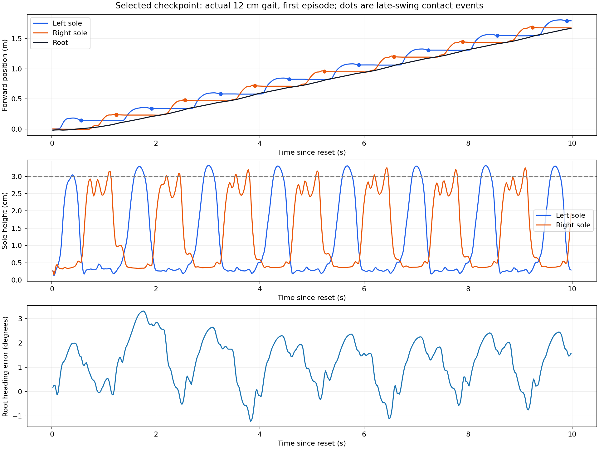
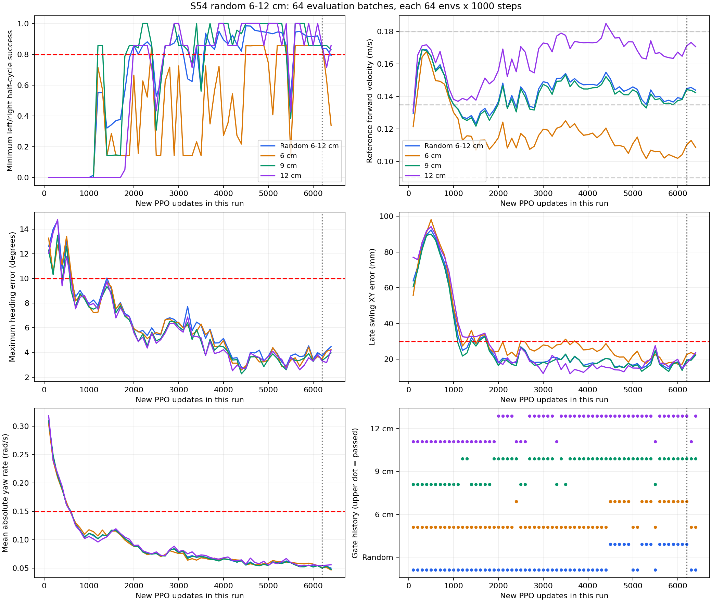
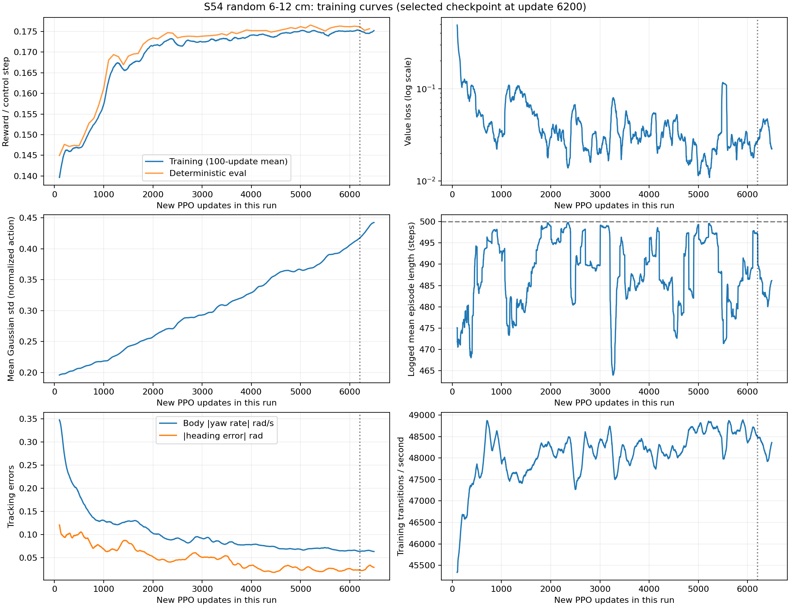

# S54随机6–12cm训练结果与参数分析

日期：2026-10-30，Asia/Shanghai。

本轮已在默认平地、默认站姿初始化条件下，通过随机6–12cm及固定6/9/12cm的现有足印/直行门槛。步长随机化确实生效，实测12cm任务的脚步几何尺度接近设定；目前仍是慢速短步行走，未验证停止、转向指令、地形、外力扰动或长时间无重置行走。本文只新增分析产物和无梯度补测，未修改训练配置或执行PPO更新。

## 数据、模型与计数

- 运行目录：`logs/straight/2026-10-29_23-43-32_random_step_6to12cm`。
- [SwanLab训练曲线](https://swanlab.cn/@yagami_light/S54-Locomotion/runs/agbkokko)。本次补测保存在报告目录，未写回原云端历史曲线。
- 本轮新增6490次完整PPO更新、850,657,280个环境转移样本。每次2048×64=131072样本；4 epochs×4 minibatches通常对应16次Adam更新，不应把一次PPO迭代理解成一次小批次梯度更新。
- 预算12小时，状态`budget_exhausted`。末尾90次更新后保存`00064_straight/model_interrupted.pt`；这个命名来自时间预算中断保存，并不表示文件损坏。
- 训练时保存64组评估，每组随机分布加固定6/9/12cm，共256次独立rollout；每次64环境×1000控制步。
- 每episode10秒，因此1000控制步是两段10秒，不能称为连续无重置20秒测试。
- `00061_straight/model_final.pt`对应本轮新增6200次更新，checkpoint的`iter=6499`含先前300次straight更新。最终`iter=6789`对应先前300+本轮6490，不存在计数冲突。
- `state.best_passed`指向“最近一次通过全部检查”的00061，并非对所有checkpoint按综合质量排名的全局最优。

## 1. 为什么目测步幅仍然小

### 实际命令没有退回3cm

保存配置同时包含`step_length=0.03`和`step_length_range=[0.06,0.12]`。随机范围启用后，sampler使用每环境`step_lengths`生成目标，3cm仅是未启用范围时的固定默认值。

训练范围是每个episode采样一次的Uniform(6,12)cm，平均只有9cm，不是每一步都走12cm。固定64环境随机eval这次采样均值为9.235cm，符合有限样本均值会偏离9cm的情况。

### “步长”与同脚stride不是同一个量

本项目的L是“摆动脚目标在实际支撑脚前方的偏移”。理想交替稳态中：

```text
相邻左右落脚的前向差约为 L
同一只脚两次落点的前向差约为 2L
完整左右循环频率 f = 0.75 Hz
交替落脚频率约为 2f = 1.5次/s
每次交替落脚间隔约为 0.667s
名义前向速度约为 2fL
```

因此6/9/12cm分别对应约0.09/0.135/0.18m/s。12cm下约10秒前进1.7m，属于慢速短步。toe/heel标记之间约24.4cm；最大左右脚前后目标差12cm仍小于一只脚的长度，视觉上两脚前后重叠较多。固定19cm横向脚间距与平均9cm前向差相比也较显眼。

### 只读测量确认12cm确实实现

另用00061做8环境×1000步固定12cm回放，不更新策略。下面统计剔除每episode前两个半周期，描述剩余落脚事件/周期；该探针与64环境eval是两次仿真，数值不应逐点混用。

| 测量 | 实际均值 | 几何参考 |
|---|---:|---:|
| 晚期接触时的双脚前后距离 | 12.56cm | 12cm |
| 同一只脚两次已观测落点的前向间距 | 23.92cm | 24cm |
| 半周期结束时双脚前后距离 | 12.28cm | 12cm |
| 摆动最高sole高度 | 3.25cm | 抬脚目标3cm，和水平步幅分开理解 |
| 支撑期sole参考点XY净位移 | 1.12cm | 越小通常越利于支撑稳定，但包含脚掌滚动，不等同接触点严格滑移 |

“步幅小”的观察与当前任务尺度一致；这里没有证据说明模型始终只迈3cm。若目标是更大几何步幅，需要在后续训练中增大L范围；提高步频主要增加速度，不能替代几何目标的扩大。

轨迹也显示左右脚的高度曲线并非完全对称，右脚摆动中有数毫米起伏；通过当前落脚门槛不等于已经形成最自然、最平滑的步态。



## 2. 你回放的00061模型

以下均来自训练时保存的64环境×1000步确定性eval；四档均通过全部现有门槛。

| 目标 | 前向速度m/s | 左/右半周期成功率 | 末期XY误差 | 最大heading偏差 | 绝对yaw速度均值rad/s |
|---|---:|---:|---:|---:|---:|
| 随机6–12cm | 0.1449 | 83.82% / 100% | 1.94cm | 3.74° | 0.0514 |
| 固定6cm | 0.1101 | 85.71% / 100% | 2.26cm | 3.49° | 0.0511 |
| 固定9cm | 0.1442 | 85.71% / 100% | 1.95cm | 3.35° | 0.0502 |
| 固定12cm | 0.1712 | 85.71% / 100% | 1.78cm | 3.31° | 0.0550 |

各档均0次terminated、128次truncated，存活比例1，连续至少8个成功半周期比例1。随机档upright=0.99831，最低有效root高度0.9403m。速度沿reset固定参考方向投影，而不是仅按机器人当前body x方向计算。

“连续8个成功”表示每个环境曾达到至少8个连续成功半周期，不要求整段所有半周期都成功。朝向误差小也不等于零侧漂：00061随机eval的最大参考方向侧向位移为15.58cm，当前门槛只限制平均侧向速度，没有侧向走廊位置门槛。最终随机补测这一指标为9.56cm；后续若要求严格沿直线轨迹，还需独立约束和测试路径误差。

85.71%是已完成半周期中的比例，不是85.71%的机器人成功。8环境12cm探针中，左脚失败集中在每episode第3个半周期（第二次左摆动，约1.3–2.0秒），原因是晚期落点/接触门槛未满足；离地和支撑均通过。其结束XY误差约3.38cm，略超3cm标准。不能把这个固定时段的失败率简单当成每一步都有14.29%的独立失败概率。

6cm速度比几何参考0.09m/s高约22%，12cm速度略低于0.18m/s。当前任务没有显式速度命令跟踪奖励，速度不需要精确等于2fL；但这种差异说明细致的范围跟随仍有改善空间。

## 3. 最终模型补测与后期回退

训练末尾最近完整评估00063出现局部回退：6cm右脚成功率33.93%，随机档右脚79.24%；9cm/12cm仍通过。因此此前根据训练时记录推荐00061有依据。

本次进一步补测预算结束的00064最终模型，随机及三个固定档现已全部通过：

| 目标 | 前向速度m/s | 左/右成功率 | 末期XY误差 | 最大heading偏差 | 通过 |
|---|---:|---:|---:|---:|---|
| 随机6–12cm | 0.1385 | 93.08% / 100% | 1.51cm | 4.68° | 是 |
| 固定6cm | 0.1031 | 85.71% / 100% | 1.72cm | 4.24° | 是 |
| 固定9cm | 0.1367 | 100% / 100% | 1.48cm | 4.57° | 是 |
| 固定12cm | 0.1671 | 85.71% / 100% | 1.50cm | 3.91° | 是 |

最终各档也均无跌倒、连续8成功半周期比例1。这是本次报告目录中的新增补测，不代表训练时最后一组原eval记录被改写。最终模型落点精度有所改善，00061朝向最大偏差略小；不能只用一个总reward决定两者优劣。

64个训练检查点中，15个同时通过随机+三个固定档，第一次全通过在本轮新增4500次更新。这里的15/64是“训练中有多少个候选通过”，不是当前策略的行走成功概率。随机档自身通过38次，固定6/9/12cm分别通过16/43/39次，6cm是主要瓶颈，不能认为最大步长一定最难。



## 4. PPO与环境参数的物理意义

| 设置 | 本轮值 | 意义与判断 |
|---|---:|---|
| 并行环境数 | 2048 | 同时收集2048条轨迹；影响吞吐和样本批量，不直接决定步幅 |
| 物理/控制频率 | 500/50Hz | 物理dt=0.002s，decimation=10，策略每0.02s给动作 |
| rollout长度 | 64 | 每环境1.28s数据，接近但略短于1.333s左右循环；有critic bootstrap，不是必须覆盖整数步态周期 |
| 每轮样本 | 131072 | 2048×64；4个minibatch时每批32768样本 |
| PPO epochs/minibatches | 4/4 | 每轮通常16次优化器更新，样本重用4遍；重用不增加新环境样本数 |
| 学习率/schedule | 1e-4/fixed | 曲线水平是设定行为；后期没有自动减小步长更新幅度 |
| desired_kl | 0.01 | 本机RSL-RL只在adaptive调度下用它调整LR；fixed下它不提供KL早停或自动降LR |
| γ | 0.995 | 折扣率；粗略1/(1-γ)=200控制步=4秒权重尺度，不等于episode长度 |
| GAE λ | 0.95 | 优势估计的偏差/方差折中；结合γ的粗略trace尺度约18.3步=0.365s |
| PPO clip | 0.2 | 概率比裁剪尺度，限制代理目标中单次策略变化；不同于动作[-1,1]限幅 |
| entropy_coef | 0.002 | 鼓励Gaussian分布保持探索；本轮后期噪声继续增长，稳定阶段值得消融较小值 |
| max_grad_norm | 1.0 | 梯度范数裁剪，不是关节力矩或动作上限 |
| actor/critic | 256/128 ELU | 均有观测归一化；输入103D、输出27D沿用旧模型 |
| 初始std | 配置0.15 | 这次完整恢复checkpoint，实际起点均值0.193，而不是重新初始化为0.15 |
| episode | 10秒/500步 | 正常timeout为truncated，跌倒为terminated；二者要分开看 |
| 根部跌倒条件 | 高度<0.55m或upright<0.5 | 环境终止条件；eval还要求更严格的最低高度≥0.85m、upright均值≥0.95 |
| action scale | 腿[.10,.15,.30,.60,.30,.10]rad/侧；腰臂.05rad | 归一化动作到默认关节姿态偏移的映射；不是米，也不能按一个标量代表全部关节 |
| action smoothing | α=0.2 | 每步20%新动作+80%旧动作，抑制快速跳变；不会把最终稳态动作幅值固定缩成20% |
| 步长采样 | episode级Uniform(6,12)cm | 同一episode保持命令，支撑切换不重新抽样，目标在半周期内缓存 |

## 5. 曲线参数怎么判断

下表对比本轮前100与最后100个已记录更新的均值。episode项只平均实际出现该字段的记录，且这些字段本身是最近结束episode的滚动统计，不能等同全样本加权平均。

| 曲线 | 前100均值 | 最后100均值 | 意义/理论判断 |
|---|---:|---:|---|
| Reward/total | 0.13968 | 0.17522 | 每控制步的加权奖励；不是满分1，需同时看落脚和方向 |
| Train/mean_reward | 65.59 | 84.64 | 最近结束episode的未折扣累计回报；随存活时长变化 |
| Train/mean_episode_length | 475.10 | 486.16 | 上限500步；训练有探索噪声，确定性eval可以更好 |
| Loss/value | 0.48887 | 0.02223 | critic回报预测误差；下降支持价值拟合改善，不单独证明好步态 |
| Loss/surrogate | 0.00133 | 0.00392 | PPO带负号的裁剪代理损失，可正可负，没有必须趋于0的统一目标 |
| Loss/entropy | -11.85 | 2.03 | 27维连续Gaussian的微分熵，可为负；不同于离散概率熵 |
| Policy/mean_std | 0.19592 | 0.44234 | 裁剪前归一化动作分布std均值，后期仍在扩大探索 |
| Tracking/heading_error_rad | 0.12089 | 0.02943 | 平均绝对朝向误差，约6.93°→1.69°，越小越好 |
| Tracking/yaw_rate_abs | 0.34756 | 0.06360rad/s | 平均绝对偏航角速度，约19.91°/s→3.64°/s |
| terminated_fraction | 5.10e-5 | 2.82e-6 | 各控制帧上的跌倒终止比例，不是episode失败概率 |
| truncated_fraction | 0.001859 | 0.001876 | 正常超时控制帧比例；长时间参考约1/500=.002，但窗口和重启会影响 |
| Perf/total_fps | 45334 | 48363 samples/s | 训练采样+优化的有效吞吐，不是单环境控制频率 |
| Perf/collection_time | 2.773s | 2.593s | 一次131072样本rollout采集用时 |
| Perf/learning_time | 0.126s | 0.124s | 一次PPO多epoch优化用时 |

每100更新会重建进程/环境，logger的最近episode缓冲也重新开始，因此episode曲线可能出现周期性启动波动；完整继承模型和优化器不意味着日志滑动窗口也被继承。本轮根据fraction折算约5871次训练terminated、1,594,154次timeout，属于含随机探索的训练统计；不能和确定性eval“无跌倒”混成一项。

训练参数没有显示明显的LR加载失效或reward/phase错位：已保存256次eval的最大reward重算误差均为0。后期轻微步态回退与持续探索并存，但本次没有做LR/entropy对照，不能据此断言某个单一参数就是原因。



## 6. 奖励贡献与理论参考

Reward及eval的reward_components已经包含权重和dt=0.02。下面“理想参考”按连续均匀相位、完美跟随计算，忽略机械约束；它不是每个离散rollout点的硬上限。

| 分项 | 00061随机eval | 理想周期均值参考 | 物理含义 |
|---|---:|---:|---|
| swing_xy | 0.02414 | 0.02667 | 后期相位更重视摆动落点 |
| stance_xy | 0.00970 | 0.01000 | 支撑脚sole保持缓存目标 |
| clearance | 0.03736 | 0.03963 | 跟踪3cm正弦抬脚参考，站立基准归一化 |
| swing_air | 0.03596 | 0.03600 | 半周期中间60%无接触且支撑存在 |
| stance_contact | 0.01000 | 0.01000 | 支撑脚接触 |
| touchdown | 0.00763 | 0.00800 | 晚期20%接触、曾离地，奖励XY容差5cm |
| upright | 0.00998 | 0.01000 | 直立cos，不约束水平朝向 |
| action_rate | -0.0000074 | 最优0 | 惩罚动作变化；不惩罚长期大幅动作或能耗 |
| unloading | 0.01199 | 0.01200 | 摆动中段卸载 |
| heading | 0.01988 | 0.02000 | 保持reset参考yaw，sigma=.35rad |
| yaw_rate | 0.00953 | 0.01000 | 抑制偏航运动，sigma=.30rad/s |
| 合计 | 0.17617 | 约0.18229 | 参考接近，但不能由高reward代替门槛与长期测试 |

swing_air和touchdown完整周期理想帧比例约0.6和0.2，不是1；00061实际为0.5994和0.1907。touchdown奖励容差5cm，严格eval容差3cm，因此奖励有得分不等于半周期成功。

XY指数exp(-100e²)在误差2/3/5cm时仍约0.961/0.914/0.779，容许数厘米残差。当前没有对速度指令、足部yaw、动作幅值或力矩能耗的独立奖励。后续想要更自然、精确或更快的步态，需要分别定义目标，不能仅追求总reward再涨。

## 7. 探索和动作限幅

| checkpoint | 全关节std均值 | 腿std均值 | 腰臂std均值 |
|---|---:|---:|---:|
| 起点300 | 0.1931 | 0.0983 | 0.2689 |
| 00061 | 0.4212 | 0.1360 | 0.6494 |
| 最终6490 | 0.4436 | 0.1391 | 0.6871 |

噪声增加主要来自腰和手臂，不能只看全关节均值认定腿部探索同样翻倍。Gaussian熵H=sum(log(std))+27/2×log(2πe)，高均值std和部分很小的关节std可以同时存在。

00061的8环境12cm确定性探针中，原始动作分量66.77%超出[-1,1]后被裁剪：腿38.97%，腰臂89.01%。左踝roll约94.38%、右髋roll约94.16%、右踝roll约89.03%处于原始动作限幅；关节目标另有约5.71%的软限位裁剪。

这些不是力矩饱和率，也不是关节穿过机械限位。action RMS约0.864很高，不代表步幅应该很大：它混合了27个动作，许多腰臂通道已经饱和，但这些通道scale只有0.05rad。应先看逐关节分布/限幅再决定是否调整动作尺度，不能直接整体翻倍。

## 8. 12小时用在了哪里

| 计时口径 | 时间 | 含义 |
|---|---:|---|
| 训练子进程硬件日志累计 | 约6.11h | 含环境初始化、加载、记录等 |
| 其中rollout采集核心计时 | 约4.70h | Physics+收集数据 |
| 其中PPO优化核心计时 | 约0.225h | 神经网络优化 |
| 独立评估子进程累计 | 约5.80h | 256次低并行度eval，接近预算一半 |

硬件日志是轮询近似计时，合计与12小时有少量进程收尾差异。不能把12小时墙钟预算理解成12小时都在优化网络。

训练时GPU平均约58.7W、利用率76.8%、显存峰值4146MiB；评估平均约13.3W。观察整个12小时的功耗会被大量64环境评估拉低。下一轮可保留常规评估并把完整6/9/12cm网格降到每500更新或重要候选执行，以增加有效训练时间；改频率后的收益尚未实测。

## 9. 下一步建议

1. 保留00061和本次已补测通过的最终模型作为对照。先用多seed、30–60秒无自动中途reset、随机初姿态/轻扰动进一步验证，再扩展“稳定”结论。
2. 先稳定6cm和启动过渡，收紧动作冗余/限幅问题。稳定阶段可对比更小的entropy或学习率，但本次未修改参数，也未验证哪组最好。
3. 若重点是更大几何步幅，下一轮可保留6–12cm样本并逐步加入12–15cm，再按分档eval扩到18cm；这些范围仅是课程候选，不是已验证训练配置。提高步频与扩大步幅应分开消融，避免同时改变多个因素。
4. 若重点是速度控制，则补充速度命令/跟踪，而不是把“足印范围”直接等同“速度命令”。停止和可控转向仍需独立任务与评估。

## 复现产物

- `analyze_run.py`：从原始文件生成CSV、统计和图表，不启动仿真。
- `training_history.csv`、`evaluation_history.csv`：6490更新和256次原eval的完整数字。
- `summary.json`：窗口统计、失败门槛、显存/功耗及最终补测汇总。
- `final_evaluation_summary.csv`：最终6490模型四档补测。
- `action_distributions.json`、`reward_comparison.json`：逐关节std及奖励参考。
- `probe_gait.py`、`gait_12cm_selected.json/.jsonl`：12cm只读步态测量与逐帧轨迹。
- `eval_final_6490*.json/.log`：最终模型的补测原始结果。

所有结论依据本地实际配置、原始日志、eval及本机RSL-RL源码；本次未开始新训练。
