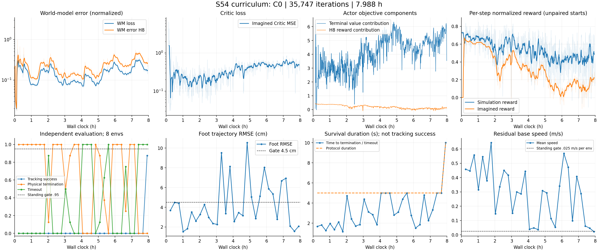

# S54 本次8小时训练结果与播放（2026-11-04）

本次实验 `s54_curriculum_fresh_auditfix_20261104_032902` **未达到完整任务目标**。它在末期产生了能连续站立10秒的候选，但未达到站立晋级标准；最终latest又发生退化。建议播放 **best_standing.pt（iteration35480）**。整个实验没有进入行走、变步长/步频或转向训练。

**后续审查补充：** 用户在viser中发现上半身异常姿态；CPU对照确认原奖励及验收没有充分约束胸腔朝向、腰部扭转和上肢。因此本报告的75%/87.5%仅代表旧足部/存活/速度协议，不能认证整机自然站立姿态。详细证据及修复设计见 [UPPER_BODY.md](UPPER_BODY.md)。

## 可直接运行的play命令

在仓库根目录、有图形桌面时执行：

```bash
/home/rm/workspace/IsaacLab_3_0/.venv/bin/python tools/play_s54_foot_tracking.py \
  --checkpoint logs/s54_curriculum_fresh_auditfix_20261104_032902/best_standing.pt \
  --viz newton_gl --episodes 3 --seconds 10
```

脚本加载实际Actor与保存的normalization，使用原Newton/MJWarp、Goal/MDP契约和动作边界，每回合施加原配置的微小reset扰动，无动作/观测噪声，默认Standing。关闭窗口或Ctrl-C结束。Episode物理终止后会打印height/tilt等原因，再开始下一回合；正常Timeout单独标识，不把它直接判成Tracking成功。默认三个回合的seed为9541/9542/9543；单环境播放与8环境评估不是同一批初始状态，不能用播放一个回合估计总体成功率。

如要对比最终策略，只把checkpoint文件名换成 `latest.pt`。两份策略均只训练过Standing，不应期待行走指令能执行成功。

SSH无桌面时，可直接打开已生成的 [10秒播放GIF](best_standing_play.gif)，或重新生成：

```bash
/home/rm/workspace/IsaacLab_3_0/.venv/bin/python tools/play_s54_foot_tracking.py \
  --checkpoint logs/s54_curriculum_fresh_auditfix_20261104_032902/best_standing.pt \
  --viz newton_gl --headless --no_realtime --episodes 1 --seconds 10 \
  --video reports/s54_curriculum_final_20261104/best_standing_play.gif \
  --out reports/s54_curriculum_final_20261104/play_smoke.json
```

GUI与GIF共用同一控制循环，已实测500控制步、10秒、exit0；视频是实际策略闭环结果，不是参考轨迹或WM imagination。本机缺少ffmpeg，GIF使用已安装Pillow，不需额外安装；MP4选项仅在ffmpeg存在时可用。脚本启动前检查共享GPU是否已有计算进程，避免并发仿真。

## 训练完成情况

| 项目 | 结果 |
|---|---:|
| 实际预算 | 28756.38秒，约7小时59分16秒 |
| 停止原因 | 达到8小时预算的保存预留点；exit0，无异常退出 |
| 最终iteration | 35747 |
| WM-only | 前1000次；Actor更新34747次 |
| WM / Critic优化步数 | 71494 / 277976 |
| 真实transitions | 367,095,808 |
| 实际课程 | 全程C0，Standing 100%；其余任务0% |
| 周期独立评估 | 31次，30次5秒Fast + 1次10秒Full |
| 评估耗时 | 353.06秒，约1.23%训练预算 |
| 设备显存 | 约17053MiB（16.65GiB）；Torch peak allocated约15106MiB |
| Actor阶段迭代速度 | 各小时中位数约1.21–1.27it/s |
| 数值与上传 | CSV中无NaN/Inf；训练退出、SwanLab最终同步均exit0 |

不是OOM或SSH中断导致失败。日志status为stopped且stop_requested=false，是预算退出的现有命名，不表示被监督器中断。



原始统计： [training_summary.json](training_summary.json)、[逐次评估CSV](evaluations.csv)、[checkpoint信息](checkpoint_summary.json)。曲线使用21条日志移动平均辅以原始数据。Simulation和imagined reward起点分布不同，图中的差值不能直接视作配对WM误差。

## Best与最终权重对比

独立复测使用原成功标准、原物理终止条件、8个环境、固定Full seed9541、10秒、相同重置扰动；两个checkpoint串行测试。

| 指标 | best_standing（35480） | latest（35747） |
|---|---:|---:|
| 本次复测Tracking成功率 | **75%（6/8）** | **0%（0/8）** |
| 物理终止率 | **0%** | **100%** |
| 正常Timeout率 | **100%** | **0%** |
| 平均持续时长 | **10.00秒** | **2.635秒** |
| Foot RMSE | **2.069cm** | **5.969cm** |
| 平均水平速度（Standing应趋近0） | **.0222m/s** | **.3298m/s** |
| 平均实际yaw rate | **.0172rad/s** | **.4384rad/s** |

原训练场景（4096环境中选择8个）在iteration35480测得 **87.5%（7/8）Tracking成功，8/8都存活10秒，Foot RMSE2.072cm**。现在8环境场景复测为6/8成功，生存率仍8/8，说明静止/跟踪指标接近阈值、结果敏感。场景规模与数值执行不同，两次不是逐bit复现；不能把一次7/8宣称成稳定87.5%的泛化成功率。没有更改统计标准。

Standing成功还要求每个环境的Foot RMSE<=4.5cm、平均yaw误差<.08rad/s、平均水平速度<.025m/s。存活10秒只是必要条件。8个环境要通过95%的Standing晋级门槛，实际需要8/8成功，并连续通过相应课程评估。

证据：[best复测](best_standing_retest.json)、[latest复测](latest_retest.json)，原训练结果在 `logs/s54_curriculum_fresh_auditfix_20261104_032902/eval_035480.json`。两个复测exit0。play单回合实测存活10秒、Foot RMSE2.20cm、平均速度.02544m/s；viewer明确没有把这次Timeout当作Tracking成功。

## 为什么曲线不好：证据和推断

**已确认：最终策略遗忘/退化。** best到latest只相差267次Actor更新、约213秒，但同一复测协议从全部存活变成全部跌倒。这段Actor参数L2变化约1.5355（用于确认确有更新，不能单独衡量策略距离）。best保存机制起了作用；最后一份不代表最好一份。末尾训练仍继续优化，缺少用真实性能退化控制Actor更新的稳定机制。

**已确认：Actor优化目标后期主要依赖Critic。** iteration30000之后，terminal bootstrap贡献的中位数约5.107，而8步直接奖励贡献约.0888；直接奖励贡献从早期约.384逐渐下降。后期imagined reward中位数仅约.17–.24，真实训练reward也比早期低。Actor loss变得更负，不能解释成站立能力变好。Horizon8仅0.16秒，远短于数秒的失稳过程，长期稳定性高度依赖价值估计。此证据支持优化与真实闭环之间仍有偏差，但不足以单独证明WM Jacobian错误或Critic是唯一原因。

**已确认：WM持续追赶变化的策略分布。** WM校准结束loss约.019；第8小时日志中位数约.222、H8 error约.334，最终日志约.231/.352。它们是归一化误差，不能换算成相同倍数的物理位置误差；但联合真实性能回退，说明1000次初始校准没有解决后续分布迁移。Critic imagined MSE峰值6.48，后期中位数约.54，未出现上一次那种几十万的数值爆炸；训练依然没有稳定收敛。

**已确认配置隐患，但因果未验证：normalization约中途冻结。** RunningNorm默认max_count=2e8；4096环境使WM和Actor统计约4.34小时达到上限，最终count=200003584，Critic也达到上限。后半程仍有明显分布变化，normalization不再更新。这可能加剧后期适应困难，需A/B验证。此前增加并行度时，没有同时校准这个以“样本数”为单位的上限，是这次配置设计的不足。

**课程设计不足：C0缺少有效的更简单子课程。** 晋级门槛按要求保留，全程只收到Standing。C0失败时降低progress对固定双脚任务没有实际降难度作用；stalled日志不能替代更容易的起始状态、稳定起步先验或WM重校准策略。于是所有预算耗在同一站立关卡，后续课程完全没有执行。这个实验不能评价当前sampler的行走/转向训练效果。

**大显存没有解决学习问题。** Replay tensor约11.2GiB，占用了大部分显存；容量3072个向量步，在本次吞吐下约覆盖十几分钟旧数据。MC辅助目标来自近期行为策略的真实物理终止片段，存在离策略和失败样本选择偏差；它能帮助校准，但不能保证Actor长期稳定。更大的Replay与更多环境都不等价于更好的策略。

观察到动作饱和比例较低，后期imagined action clip fraction中位数约.31%，不足以把全部失败归因于动作裁剪。最新策略复测Critic在真实物理终止回报上的平均偏差约-.66（低估），也说明本次末尾失效不能继续只用“Critic正向爆炸”解释。

## 下一步建议（本次没有启动新训练）

1. 保存best35480作为候选，先用多随机种子验证10/20/30秒站立和漂移，明确其真实能力；不能先进入行走。
2. 做短、受控的Actor更新稳定性试验：降低Actor更新速度或频率，引入真实站立退化时暂停Actor并校准WM/Critic的规则，保留健康快照。先验证小范围变化，避免再直接消耗8小时。
3. 用Newton录制的相同状态/动作做WM的1/4/8步配对误差和局部动作扰动响应检查，再决定Critic目标稳定化或bootstrap梯度权重；不能只调大Horizon。
4. 校准RunningNorm样本上限、Replay新旧数据比例。用实际吞吐比较512/1024/4096环境，选择真实性能稳定的设置，显存占用作为资源约束。
5. 把C0拆成近稳定初始状态、逐步增加原有reset扰动、延长持续时长等子课程，保持物理终止与最终成功标准；Standing通过后才加入短步。

离线重画本报告曲线：

```bash
/home/rm/workspace/IsaacLab_3_0/.venv/bin/python tools/analyze_s54_training.py \
  --run_dir logs/s54_curriculum_fresh_auditfix_20261104_032902 \
  --out_dir reports/s54_curriculum_final_20261104
```

play和分析脚本新增于本次；训练实现、原实验日志、checkpoint及成功阈值均未修改。新增诊断只用于分析结果，不冒充原8小时内完成的评估。
