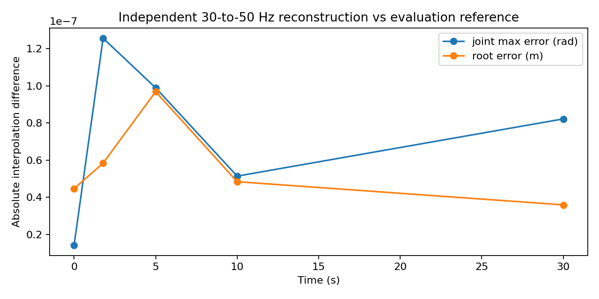
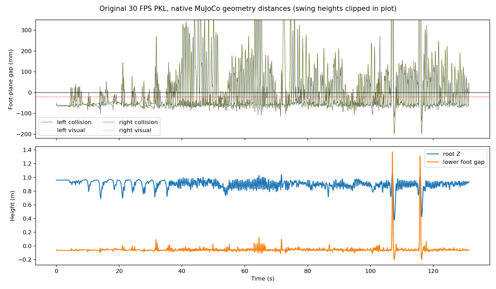
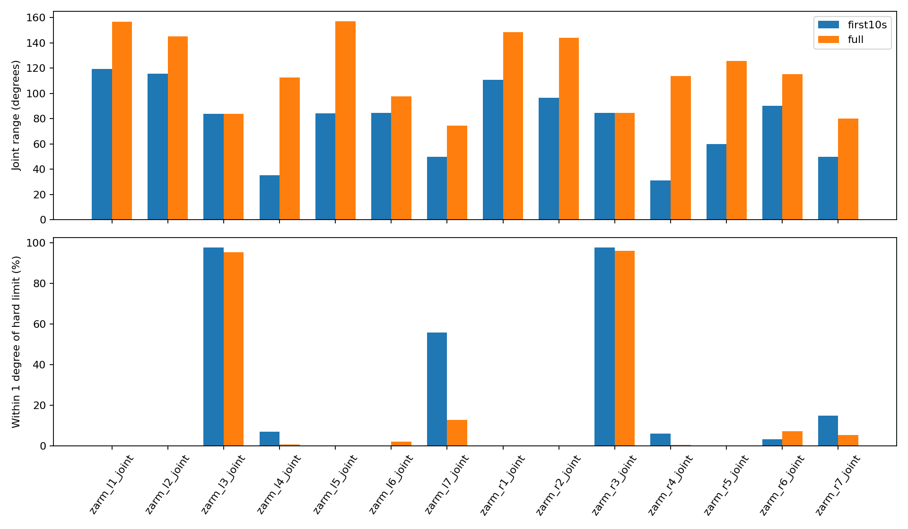
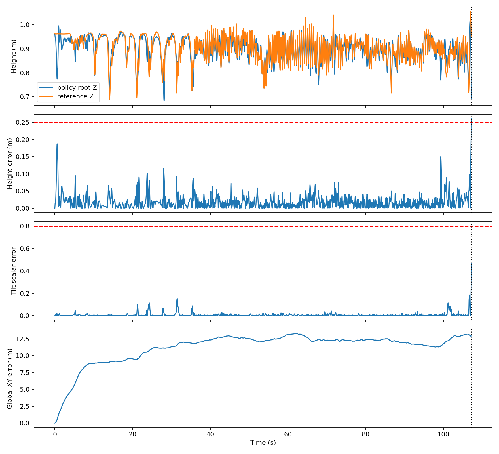
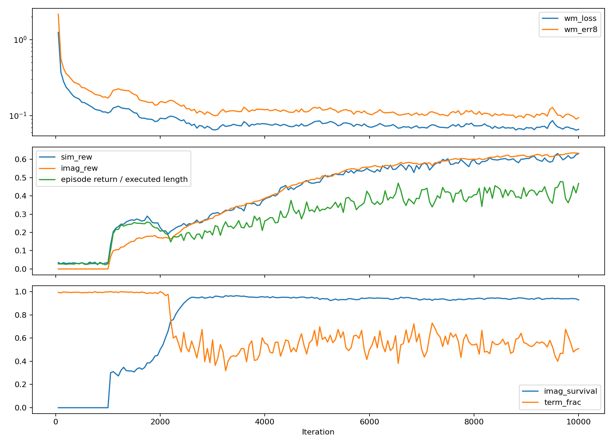

# S54 Reference Motion 诊断报告

> 数据清理说明（2026-10-27）：本文为历史实验记录，对应旧 Reference 和中间版本已删除。当前仅保留 `data/retarget_data/raw/` 的原始 BVH；重新生成请使用 `README_S54.md` 的命令，默认输出到 `data/retarget_data/reference/`。

日期：2026-10-27（Asia/Shanghai）。诊断对象：`logs/s54_dance1` 的10000 iteration checkpoint及已有轨迹。
本次只新增诊断脚本、数值表和图表；没有重训、重定向、修改IK权重或覆盖PKL/CSV/MJCF/USD/Checkpoint/训练日志。

## 1. Executive Summary

1. **确认存在系统性足底穿地，而且视觉网格也穿地。** 左/右碰撞足底gap中位数为 **−53.21 / −48.36 mm**；超过5mm的帧占 **74.47% / 68.47%**；最深 **134.78 / 199.19 mm**。这不是脚踝原点被误当脚底得到的结果。
2. **确认一组不能同时满足的足部IK位置任务。** `leg_*5_link`和`leg_*6_link`原点在任意姿态下重合，配置却分别跟踪Toe和Foot；按现有GMR代码重建的两个目标相距 **208.145 mm**。这使求解器必须折衷。
3. **即使精确满足Foot body目标，足底也仍穿地。** 把真实足底碰撞几何刚性放到Foot目标位姿，左右gap中位数仍为 **−50.90 / −45.37 mm**。应修Foot/Toe帧定义和足底约束，不能只归因于迭代次数不足或整体root偏低。
4. **确认上肢重定向失真，但不是整条手臂没有运动。** `zarm_l3/r3_joint`在全clip中 **95.18% / 96.05%** 的帧位于硬限位1°以内；上臂近水平外展占 **69.13% / 72.55%**，原始人体只有 **3.50% / 5.40%**。肘和腕有显著运动；当前模型没有手指关节。
5. **数据传递正确。** PKL→GMR CSV→训练CSV的27维关节及root数值最大差均为0。3945帧/30FPS只重采样一次，得到6574帧/50Hz；实际MotionLib和NPZ的root位置、关节数值相同。
6. **未发现当前模型结构/坐标的关键不一致。** GMR MJCF、复制源MJCF、仿真MJCF的关节、body frame、惯量和几何数值一致；70帧原生FK、PyTorch FK、renderer ghost FK一致。当前USD静态关节/质量/惯量检查通过，零位body和足底碰撞边界也匹配。
7. **评估不是从起点立即摔倒。** 首次终止在 **107.20 s**，由高度误差 **0.26059m > 0.25m** 触发；tilt标量误差 **0.46408 < 0.8**。此时Reference自身处于倒置动作段。
8. **另一个重要问题是全局路径漂移。** 10s时XY偏差 **8.805m**，存活段XY偏差中位数 **12.131m**；同时按奖励方式重对齐的身体位置RMSE中位数仅 **0.0626m**。默认ghost跟随Policy的xy/yaw，隐藏了这类全局漂移。

归因边界：穿地、冲突目标、上肢贴限位、全局漂移是测量事实；它们对最终失败各贡献多少，需要修复后的受控对照。本次不把“Hand位置权重为0”单独认定为全部根因，也不把0.5334直接解释为“只会站稳”。

## 2. Data Pipeline Audit

### 2.1 文件与时间轴

| 级别 | 实际文件/字段 | 检查结果 |
|---|---|---|
| BVH | `Leju-GMR/assets/lafan1_bvh/dance1_subject1.bvh` | header:3945帧，Frame Time=0.033333s，约30FPS；未下载新文件 |
| PKL | `output/kuavo_s54/pkl/dance1_subject1_30fps.pkl` | fps=30.0，root_pos(3945,3)，root_rot(3945,4)为xyzw，dof_pos(3945,27) |
| GMR CSV | `output/kuavo_s54/csv/dance1_subject1.csv` | (3945,34)，与PKL对应数组最大绝对差0 |
| 训练CSV | `retarget_data/lafan1_s54/dance1_subject1.csv` | (3945,36)，前34列与GMR CSV最大差0，最后两列恒为合法默认值0 |
| MotionLib | `supermimic/motion.py` | 30→50Hz线性插值+四元数SLERP，6574帧；末时间131.46s |
| NPZ Reference | `logs/s54_dance1/traj_10000.npz` | ref_root_p(6574,3)、ref_root_R(6574,3,3)、ref_q(6574,29) |
| NPZ Policy | 同上 | root_p(5361,1,3)、root_quat为wxyz、q(5361,1,29)、f/alive(5361,1)；包含terminal state |

源最后时间131.4666667s，控制时间网格向下取整至131.46s；不是把30FPS误当50FPS，也没有再次50→50重采样。BVH header小数舍入与30.0FPS的差仅约1.3ms/全clip。
所有原始/训练数值finite；root quaternion norm最大误差 **1.221e-15**。

BVH→PKL是IK映射，不应要求两种骨架的关节值相等。本次复用了当前GMR BVH loader与目标构造代码，核对源帧数、单位、目标轨迹与PKL对应关系；**没有重跑IK，也没有原始导出时的完整CLI记录，不能证明当前代码/初始参数能逐位复现历史PKL**。这不影响PKL与后续CSV完全一致的结论。

### 2.2 关节顺序（0-based）

| 语义 | MJCF/Policy名称 | PKL dof索引 | CSV列 | 完整29维/实际sim索引 |
|---|---|---|---|---|
| 左腿 | leg_l1_joint…leg_l6_joint | 0–5 | 7–12 | 0–5 |
| 右腿 | leg_r1_joint…leg_r6_joint | 6–11 | 13–18 | 6–11 |
| 腰 | waist_yaw_joint | 12 | 19 | 12 |
| 左臂 | zarm_l1_joint…zarm_l7_joint | 13–19 | 20–26 | 13–19 |
| 右臂 | zarm_r1_joint…zarm_r7_joint | 20–26 | 27–33 | 20–26 |
| 头yaw | zhead_1_joint | 无 | 34（补齐） | 27 |
| 头pitch | zhead_2_joint | 无 | 35（补齐） | 28 |

PKL的dof_layout明确记录legs0–11、waist12、arms13–26；编译MJCF逐关节名称顺序与此一致。
训练日志`stdout.log:57`打印的canonical→sim映射也是0–28；`env.py`读写都使用名称求出的双向permutation。没有发现左右腿/臂互换。
头部默认qpos0=0，范围分别±1.5708、±0.523599rad，补齐合法。
GMR `data_loader.py`把PKL xyzw转wxyz，`robot_motion_viewer.py`同样在27维末尾补两个0；与SuperMimic的参考一致。

### 2.3 同物理时间对照

使用独立SciPy线性插值/SLERP重建30→50Hz，并同时与真实MotionLib比较；1.78s对应原始第53.4帧、控制第89帧。

| 物理时间 s | 控制帧 | 原始分数帧 | Root误差 m | 旋转误差 rad | Joint最大误差 rad |
|---|---|---|---|---|---|
| 0 | 0 | 0.0 | 4.468e-08 | 1.368e-07 | 1.432e-08 |
| 1.78 | 89 | 53.4 | 5.842e-08 | 3.066e-08 | 1.256e-07 |
| 5 | 250 | 150.0 | 9.685e-08 | 1.573e-07 | 9.895e-08 |
| 10 | 500 | 300.0 | 4.843e-08 | 4.759e-08 | 5.143e-08 |
| 30 | 1500 | 900.0 | 3.596e-08 | 7.363e-08 | 8.221e-08 |


实际MotionLib与NPZ：root位置/关节差0，旋转差约 **5.496e-15rad**。
独立float64重建与MotionLib全clip最大差：root **2.087e-05m**、joint **2.481e-04rad**、旋转 **9.820e-05rad**。
后者是MotionLib的float32分数帧时标/三角函数精度差，最大joint约0.0142°；不是时标错位，无法解释厘米级穿地或大幅上肢失真。



本诊断按数组数值、物理时间、名称和FK判断一致性，未实现文件hash或以hash作诊断依据。

## 3. Foot Penetration Analysis

### 3.1 几何定义

- 地面是源MJCF的`floor` plane：position=(0,0,0)，normal=(0,0,1)。训练场景地面和renderer地面也位于z=0。
- 左右足底body是`leg_l6_link/leg_r6_link`，父body `leg_l5_link/leg_r5_link`为ankle pitch。
- `leg_*6_link`相对`leg_*5_link`的translation和joint anchor均为0，故两个body原点在任意关节角下重合；它们不是脚踝与脚尖两个点。
- `l_ft_frame/r_ft_frame` site的local pos=(0,0,0)，其高度等于Foot link原点，**并非真实足底**。
- 每只脚13个碰撞proxy：11个radius=8mm的横向capsule、2个box。box中心/半尺寸为(0.042,0,−0.041)/(0.045,0.05,0.0054)，及(−0.036,0,−0.054)/(0.021,0.048,0.0054)，单位m。
- capsules的x覆盖−0.063到0.165m，各条横向半长0.020–0.046m，z中心−0.043至−0.054m；胶囊最低点在foot local z=−0.062m。
- 视觉mesh是`l_foot_roll/r_foot_roll`；本地bbox约x[−0.073164,0.170836]、y[−0.05,0.05]、z[−0.059500,0.014000]m。
- 必须用实际旋转后的几何最低点。前10秒foot法向倾斜中位数左25.39°、右23.40°，toe端会比“原点减6.2cm”更低。全clip原点与最低碰撞点的高度差中位数约12.9cm。

完整碰撞参数位于`diagnosis_metrics.json -> feet.collision_geometry`；源XML对应`biped_s54.xml:99`附近。

### 3.2 测量方法与接口验证

逐帧写入原始PKL数值的root/27关节，按名称补两个头部默认值，调用原生`mj_forward()`。
对每只脚所有碰撞proxy调用`mj_geomDistance(floor,geom,distmax=10)`，取最小有符号距离。
对实际box/capsule各做已知 **−20mm穿透 / +30mm分离** 测试，共8项；均正确。
另用box/capsule支持点公式独立核对全3945帧，最大差 **2.220e-16m**。
视觉mesh则用MuJoCo编译后的mesh vertices、实际geom world transform求最低点，没有把link/site当作足底。
几何距离查询不依赖碰撞mask是否配对；源floor漏配左脚不妨碍此次距离诊断。

| 指标 | 左脚 | 右脚 |
|---|---|---|
| Minimum | -134.78 mm | -199.19 mm |
| P5 | -71.93 mm | -66.80 mm |
| Median | -53.21 mm | -48.36 mm |
| P95 | 139.88 mm | 239.94 mm |
| Maximum（摆动/倒置） | 1437.61 mm | 1742.49 mm |
| 穿透 >5 mm | 74.47% | 68.47% |
| 穿透 >20 mm | 69.25% | 64.69% |
| 视觉Mesh穿透 >5 mm | 73.89% | 68.09% |


双脚同时穿透>5mm占 **45.68%**，同时>20mm占 **37.69%**。
每帧较低脚的gap中位数 **−59.83mm**、P95 **−28.86mm**。摆动脚离地正常；正gap未被计作错误。
视觉gap中位数左−52.44/右−47.46mm；视觉最低点比碰撞体高的中位差约0.89/0.94mm。
绝大部分差异是毫米级，不能解释普遍5cm的穿地；少量特殊姿态视觉最低点反而低于proxy，极值差−33.56/−15.75mm，属于另一项局部几何近似误差。

最严重时间点：

| 脚 | 原始帧(0-based) | 时间 s | gap mm | root Z m |
|---|---|---|---|---|
| left | 3492 | 116.40000 | -134.78 | 0.4332 |
| left | 3489 | 116.30000 | -131.78 | 0.4636 |
| left | 3491 | 116.36667 | -129.22 | 0.4294 |
| left | 3493 | 116.43333 | -124.47 | 0.4462 |
| left | 3488 | 116.26667 | -118.57 | 0.4968 |
| right | 3491 | 116.36667 | -199.19 | 0.4294 |
| right | 3228 | 107.60000 | -199.19 | 0.3784 |
| right | 3229 | 107.63333 | -196.87 | 0.3754 |
| right | 3490 | 116.33333 | -196.86 | 0.4338 |
| right | 3227 | 107.56667 | -195.28 | 0.3890 |


### 3.3 Root高度与真正原因

Root Z最小 **0.375405m**、最大 **1.055794m**、范围 **0.680390m**。
存在系统性的“足底相对地面偏低”，但证据不支持把它简化为单一常量root offset：

1. **Foot/Toe位置约束冲突已确认。** IK配置`bvh_lafan1_to_kuavos54.json:73–113`用weight400的Foot目标驱动`leg_*6_link`，用weight120的Toe目标驱动`leg_*5_link`。机器人两点距离恒0，而重建人体目标距离全clip恒约0.208145m。这不可能被更多IK迭代完全满足。Mink把cost乘到残差/Jacobian，再做最小二乘；400/120会形成折衷，不是两个硬位置等式。
2. **Foot目标本身没有足底接地含义。** 精确把13个foot proxies放到重建的Foot目标位姿，左右最低gap中位数仍−50.90/−45.37mm，低于−5mm占74.80%/68.95%。目标常有20°–30°foot pitch；沿用人体骨骼姿态offset并不保证机器人toe/heel在地面上。
3. 实际PKL到Foot目标的position residual中位数约17.29/17.35mm，z residual中位数约−6.33/−6.36mm；极端时左−122.36mm、右−151.30mm。这进一步加重落地/深蹲片段的穿透。Foot orientation residual中位数仅1.56°/1.31°，说明“完全没有跟上姿态目标”也不足以解释系统偏差。
4. Root最低和最大穿透集中在107.6s、116.3s附近的剧烈动作/落地处；不是所有帧都可用同一个抬高量合理修复。若按最坏值抬约20cm，会使正常支撑段多出约15cm的离地间隙。

### 3.4 GMR接地逻辑

代码依据：`motion_retarget.py:84,125,277–284,421–449`，`scripts/bvh_to_pkl.py:638–671,1041–1085,1330–1332`。

- config `ground_height=0`；它进入pos offset，不是对机器人sole的非穿透约束。
- `ground_offset`默认0，`apply_ground_offset()`对人体目标z做**减法**；正值会让目标降低。不能把增加正offset当成“抬高机器人”。
- 当前BVH脚本明确`retarget(...,offset_to_ground=False)`；没有启用人体最低Foot平移。
- 即便启用`offset_human_data_to_ground()`，它只是把人体Foot节点最低点抬到0.1m，并非机器人碰撞足底贴地约束，不能直接当成修复。
- 默认只设`mink.ConfigurationLimit`；velocity limit与collision avoidance默认关闭。当前构造器没有建立足底-plane非穿透约束。源模型有floor、viewer能播放、甚至`mj_forward()`算出contact，都不会投影修改已写入qpos。
- BVH loader将cm乘0.01、Y-up转Z-up；数值量级与当前PKL一致，没有100倍单位错误的证据。LAFAN loader把human_height写成1.75m，config assumption=1.7m，故目标scale ratio=1.029412；LeftArm/RightArm的额外scale为1.2。这个比例不是机器人身高自动标定，需要在修正帧定义后再校准。
- Initial Knee Flexion默认0.1×joint range，S54膝约0.253073rad（14.5°）；只影响首次求解初值，不能保证后续足底非穿透。历史导出究竟使用何种CLI初值未被PKL记录。



## 4. Upper-Body Motion Analysis

### 4.1 每关节统计

统计直接对应PKL的14个臂关节；数据已证实与训练CSV同值。前10s含t=10s端点，共301帧；RMS角速度用30FPS中心差分，没有角度裁剪或平滑。

前10秒：

| joint | min ° | max ° | range ° | std ° | RMS dq rad/s | 距硬限位≤1° % |
|---|---|---|---|---|---|---|
| zarm_l1_joint | -126.18 | -6.99 | 119.20 | 12.45 | 1.573 | 0.00 |
| zarm_l2_joint | 7.30 | 122.85 | 115.55 | 16.35 | 1.156 | 0.00 |
| zarm_l3_joint | -85.00 | -1.35 | 83.65 | 7.86 | 1.016 | 97.67 |
| zarm_l4_joint | -35.16 | 0.00 | 35.16 | 11.76 | 0.264 | 6.98 |
| zarm_l5_joint | -85.04 | -0.87 | 84.17 | 12.61 | 0.601 | 0.00 |
| zarm_l6_joint | -70.10 | 14.28 | 84.38 | 29.43 | 0.470 | 0.00 |
| zarm_l7_joint | -40.00 | 9.75 | 49.75 | 20.68 | 0.421 | 55.81 |
| zarm_r1_joint | -122.08 | -11.39 | 110.69 | 10.98 | 1.454 | 0.00 |
| zarm_r2_joint | -103.77 | -7.16 | 96.61 | 13.80 | 1.216 | 0.00 |
| zarm_r3_joint | 0.65 | 85.00 | 84.35 | 8.25 | 0.986 | 97.67 |
| zarm_r4_joint | -31.22 | 0.00 | 31.22 | 8.72 | 0.270 | 5.98 |
| zarm_r5_joint | 0.48 | 60.45 | 59.97 | 10.08 | 0.454 | 0.00 |
| zarm_r6_joint | -15.28 | 75.00 | 90.28 | 35.41 | 0.497 | 3.32 |
| zarm_r7_joint | -40.00 | 9.71 | 49.71 | 18.19 | 0.361 | 14.95 |


完整131.47秒：

| joint | min ° | max ° | range ° | std ° | RMS dq rad/s | 距硬限位≤1° % |
|---|---|---|---|---|---|---|
| zarm_l1_joint | -163.60 | -6.99 | 156.61 | 17.40 | 1.537 | 0.00 |
| zarm_l2_joint | 7.30 | 152.19 | 144.89 | 24.51 | 2.100 | 0.00 |
| zarm_l3_joint | -85.00 | -1.35 | 83.65 | 3.64 | 0.431 | 95.18 |
| zarm_l4_joint | -112.66 | 0.00 | 112.66 | 23.04 | 1.114 | 0.66 |
| zarm_l5_joint | -85.04 | 71.96 | 157.01 | 31.60 | 0.971 | 0.00 |
| zarm_l6_joint | -75.00 | 22.61 | 97.61 | 22.39 | 0.923 | 2.13 |
| zarm_l7_joint | -40.00 | 34.61 | 74.61 | 16.45 | 0.847 | 12.88 |
| zarm_r1_joint | -159.97 | -11.39 | 148.58 | 15.56 | 1.479 | 0.00 |
| zarm_r2_joint | -147.31 | -3.46 | 143.84 | 23.88 | 1.944 | 0.00 |
| zarm_r3_joint | 0.65 | 85.00 | 84.35 | 2.96 | 0.346 | 96.05 |
| zarm_r4_joint | -113.48 | 0.00 | 113.48 | 23.76 | 1.021 | 0.46 |
| zarm_r5_joint | -65.05 | 60.45 | 125.49 | 27.53 | 0.896 | 0.00 |
| zarm_r6_joint | -40.00 | 75.00 | 115.00 | 25.21 | 0.878 | 7.22 |
| zarm_r7_joint | -40.00 | 40.00 | 80.00 | 17.86 | 0.879 | 5.35 |


大range不等于持续变化：l3/r3的全范围仍约84°，但std仅3.64°/2.96°，95%以上时间贴在−85°/+85°；短暂初始变化拉大了range。
肩pitch/roll、肘和腕都有明显变化；不能认定“两臂全部冻结”。前10秒肘活动约35.16°/31.22°，全clip约112.66°/113.48°；腕3维同样有较大变化。

### 4.2 手部轨迹与人体对照

末端选`zarm_l7_link/zarm_r7_link`原点。Root局部坐标用R_root转置乘(hand_world−root_world)，同时消除平移和姿态影响。

| 范围 | 手 | 世界坐标 Δxyz m | Root局部坐标 Δxyz m |
|---|---|---|---|
| first10s | left | 0.521, 3.233, 0.644 | 0.572, 0.469, 0.625 |
| first10s | right | 0.806, 3.355, 0.602 | 0.515, 0.470, 0.635 |
| full | left | 7.046, 5.823, 1.496 | 1.012, 0.762, 1.006 |
| full | right | 7.775, 7.121, 1.502 | 0.990, 0.774, 0.914 |


定义“近水平外展”：肩到肘向量在Root坐标系的仰角绝对值<15°，且横向分量绝对值/向量长度>cos30°。S54用shoulder1→elbow4，人体用LeftArm→LeftForeArm（右侧对应），人体坐标基采用GMR root target修正后的方向。

| 范围 | 手臂 | S54近水平外展 | 人体近水平外展 |
|---|---|---|---|
| first10s | left | 94.35% | 0.00% |
| first10s | right | 91.03% | 29.90% |
| full | left | 69.13% | 3.50% |
| full | right | 72.55% | 5.40% |


该阈值是姿态描述指标，不是医学/运动学标准；两种骨架上臂起点存在少量解剖差异。GMR root target与PKL root方向残差中位数约3.43°，不足以解释69%对3.5%这种差距。
当前权重下，手末端到重建人体Hand位置目标的距离中位数左0.550m、右0.565m；Hand orientation residual中位数左25.59°、右21.93°。这些hand position残差目前权重为0，不是求解器正在优化的误差。

### 4.3 IK解释与手指能力

`ik_configs/bvh_lafan1_to_kuavos54.json:45–57,115–155`：Shoulder位置120/姿态10；Arm位置0/姿态10；ForeArm位置0/姿态5；Hand位置0/姿态8。table2关闭，posture regularizer未配置，配置限位仍有效。

- Hand位置权重0意味着它不约束reach位置；手可在很不同的位置只匹配部分姿态。零位置权重是合理嫌疑，但**不是已证明唯一根因**。
- shoulder1的body origin位于肩关节处，自己的3个肩关节旋转不会移动这个起点；给Shoulder位置120并不等于约束手的位置或上臂方向。
- ±85°持续贴边、与人体上臂方向显著不同、较大手部目标残差共同支持优先检查`rot_offsets`、body对应关系和旋转轴方向。还需在T-pose/自然垂臂关键帧核对各body本地轴；不能只提高Hand位置权重就宣称解决。
- 7DoF手臂提供肩部3轴、肘1轴、腕3轴，可在关节范围内表达手部位置、肘屈伸和手腕姿态。
- 当前MJCF没有finger/thumb活动关节；手指外观属于静态mesh，PKL/CSV/Policy也没有手指通道。当前模型不能表达单指弯曲/张开。
- **没有手指不能解释肩部T形外展**；这个问题已存在于GMR输出的Reference，应在重定向侧修复。本次没有改任何IK权重。



## 5. Simulator and FK Consistency

### 5.1 当前实际模型

- GMR源：`Leju-GMR/assets/kuavo_s54/xml/biped_s54.xml`。
- SuperMimic FK源：`data/s54_description/xml/biped_s54.xml`。
- 仿真副本：`data/s54_description/xml/s54_sim.xml`。
- 实际USD：`data/s54_newton_usd/s54_sim/s54_sim.usda`，Physics=mujoco。
- `robot.py`29个PD执行器；`env.py`使用Newton/MJWarp；MDP跟踪14个body，包含base/腿/腰/肩/肘/手。

源与两份MJCF的body parent/pos/quat、joint type/axis/anchor/range、qpos0、mass/COM/inertia逐数组差0；对应robot geoms的位置、旋转、尺寸、类型也相同。
仿真副本删除floor和源torque motors/sensors、改变contact masks，由唯一场景地面及Isaac PD驱动；这些是已记录的有意差异。GMR floor mask1/0不与左脚1/2配对；仿真proxy统一1/1，左/右脚均可接触地面。

USD审计核对了全部29个revolute joints的父子关系、joint frames/axes/ranges、root articulation、Z-up/metre、质量/COM/inertia。
当前USD body零位world position/rotation与源的最大差为 **0.000e+00m / 0.000e+00rad**；两脚各13个collision prim，总共47个，无内置world floor。
零位脚碰撞最低z：MJCF −0.151700000m，USD −0.151700008m，差约7.6e-9m。这是源root=.82m且关节全0的直腿姿态，不是本动作参考root；`robot.py`spawn初值会提高至安全高度，reset再写入Reference。

### 5.2 独立FK与renderer

70个参考样本覆盖全clip及关键时刻，全部30个body参与：

| 对比 | 最大位置差 m | 最大旋转差 rad |
|---|---:|---:|
| 原生MuJoCo vs PyTorch FK（float64诊断） | 2.844e-15 | 7.302e-16 |
| GMR源 vs仿真MJCF原生FK | 0.000e+00 | 同一关节/body定义 |
| 原生MuJoCo vs renderer原始ghost FK | 2.887e-15 | 9.069e-16 |

本次不重跑Newton训练或Checkpoint evaluation。已有`results/s54/newton_1env.json/newton_16env.json`是先前真实backend roundtrip/接触测试；它们是历史证据，不冒充本次重新测得的动力学数据。当前USD只做静态/零位审计，不能据此证明全部接触动力学与MuJoCo CPU逐步相同。

CSV/PKL是xyzw；原生MuJoCo和SuperMimic内部为wxyz；Isaac Lab3接口为xyzw。读取/写入处均有显式转换。Root统一为base_link，没有保留G1 pelvis/torso坐标。

### 5.3 “Reference看起来不同”的可视化因素

`tools/render.py:144–149`默认把ghost的xy移到Policy root，并按相对yaw旋转；这是与body tracking reward一致的局部对齐。**NPZ Reference没有因此改变**，但画面里ghost的全局路径与GMR直接播放不一样。
`--global_ghost`可关闭对齐；当Policy已经偏离十余米，固定跟随Policy的小视野可能看不到ghost，应结合XY误差曲线或全局视野观察，不应据此认定CSV错误。
终止后renderer冻结真实terminal Policy并标记terminated，Reference继续运动，不能把冻结后画面用于后续跟踪性能判断。
此前白天空/白地面/白机器人过曝来自材质和灯光；目前renderer已采用灰白机器人、青色reference和蓝灰天空/深灰地面。**颜色是可视化问题，穿地不是。** 本次诊断没有修改renderer或模型来隐藏穿地。

## 6. Evaluation Failure Analysis

### 6.1 首次终止

`alive`第一次False位于记录索引 **5360**、Reference控制帧 **5360**，时间 **107.20s**。f序列连续0…5360，无中途reset；完整动作应到131.46s。
使用当前`mdp.termination()`重新检查所有记录状态，首次阈值越界同样在5360。

| 状态 | 107.18s（仍alive） | 107.20s（terminal） |
|---|---:|---:|
| Policy root Z m | 0.728991 | 0.691921 |
| Reference root Z m | 0.971190 | 0.952515 |
| Height error m | 0.242200 | **0.260594** |
| Policy Rzz | −0.778105 | −0.770855 |
| Reference Rzz | −0.381228 | −0.306774 |
| Tilt scalar error | 0.396877 | 0.464082 |

阈值见`mdp.py:151–156`：height>0.25m或`abs(ref_Rzz−policy_Rzz)>0.8`。
**0.8是矩阵元素差，不是0.8rad。** 本次height触发，tilt未触发，也不是clip结束或训练500步timeout。
终止时Policy Euler xyz≈[144.10°,17.90°,76.57°]，Reference≈[108.68°,16.68°,75.50°]，两者自身都处于倒置/翻转动作段。
Policy wxyz quaternion=[0.3306330740451813, 0.7079333066940308, 0.6198855638504028, 0.07248573750257492]。

终止前后全部29维关节状态：

| joint | 107.18s Policy rad | 107.20s Policy rad | 107.20s Reference rad |
|---|---|---|---|
| leg_l1_joint | 0.11892 | 0.08426 | 0.29785 |
| leg_l2_joint | 0.55752 | 0.54629 | 0.18803 |
| leg_l3_joint | -1.01894 | -1.03234 | -1.20671 |
| leg_l4_joint | 2.19097 | 2.26186 | 2.45281 |
| leg_l5_joint | 0.08669 | 0.07881 | 0.15435 |
| leg_l6_joint | 0.12594 | 0.12511 | -0.26180 |
| leg_r1_joint | -0.63074 | -0.61562 | -0.66322 |
| leg_r2_joint | 0.39820 | 0.39244 | 0.77676 |
| leg_r3_joint | -0.00216 | -0.00452 | -0.52380 |
| leg_r4_joint | 1.73340 | 1.75487 | 2.08332 |
| leg_r5_joint | 0.14710 | 0.13847 | -0.04840 |
| leg_r6_joint | 0.04689 | 0.04345 | 0.26180 |
| waist_yaw_joint | -0.38675 | -0.40358 | -0.19805 |
| zarm_l1_joint | -2.90761 | -2.90332 | -2.85533 |
| zarm_l2_joint | 0.54020 | 0.60431 | 0.27375 |
| zarm_l3_joint | -1.11266 | -1.09420 | -1.38966 |
| zarm_l4_joint | -0.68249 | -0.70286 | -0.98922 |
| zarm_l5_joint | -0.48663 | -0.46797 | -0.30032 |
| zarm_l6_joint | 0.47813 | 0.45489 | 0.39385 |
| zarm_l7_joint | -0.19510 | -0.16367 | -0.12441 |
| zarm_r1_joint | -2.17296 | -2.19414 | -2.37459 |
| zarm_r2_joint | -1.10072 | -1.09699 | -1.06001 |
| zarm_r3_joint | 0.76555 | 0.74264 | 1.48318 |
| zarm_r4_joint | -2.04789 | -2.24748 | -0.96951 |
| zarm_r5_joint | 0.28999 | 0.28659 | 0.36244 |
| zarm_r6_joint | -0.59044 | -0.52155 | -0.52003 |
| zarm_r7_joint | -0.47625 | -0.43289 | 0.20083 |
| zhead_1_joint | 0.45265 | 0.45259 | 0.00000 |
| zhead_2_joint | 0.41581 | 0.41961 | 0.00000 |


107.20s的Reference脚gap约+1.217m/+0.543m，Policy约+1.086m/+0.706m，都是空中状态。
因此不能说“这一时刻脚穿地直接触发终止”；116.37s的最深穿透也在已记录失败之后，不能用后来的极值倒推107.2s的直接原因。
更有依据的描述是：长期参考接触不一致和局部姿态/全局漂移已经存在，随后在106–108s的高难度倒置动作附近，高度跟踪误差越过阈值。各因素的因果贡献尚需对照实验。

### 6.2 局部模仿与全局漂移

| 时间 s | XY偏差 m | Policy左/右足 gap mm | Ref左/右足 gap mm |
|---|---|---|---|
| 0 | 0.000 | -55.42/-49.75 | -55.42/-49.75 |
| 1.78 | 2.426 | 11.28/-4.59 | -65.06/-61.94 |
| 5 | 5.636 | 0.13/-4.07 | 19.14/-62.94 |
| 10 | 8.805 | -2.31/8.33 | -63.58/-55.59 |
| 30 | 11.299 | 0.02/-1.50 | -59.24/-53.29 |
| 60 | 13.090 | -1.67/9.74 | -72.03/-37.42 |
| 100 | 11.732 | 9.78/1.28 | 42.90/-61.41 |
| 107.2 | 12.905 | 1085.96/706.02 | 1216.55/542.54 |


对应足底状态来自已有Newton轨迹写回同一MuJoCo几何后的FK测量，不是新模拟。
例如1.78s：Reference双足约−65.06/−61.94mm，而Policy约+11.28/−4.59mm；物理机器人不能同时严格跟随这套穿地参考并满足地面接触。
存活段按奖励方式xy/yaw对齐后的身体位置RMSE：中位 **0.06263m**、P95 **0.13807m**；关节RMS误差 **0.34802rad**。
全局root XY误差：中位 **12.13085m**、最大 **13.26044m**。
因此不能把策略描述成“完全没学模仿”，但它确实没有准确跟随全局平移路径。

代码层面：body position/orientation reward对齐xy/yaw；root position reward仍比较绝对世界位置（std0.3m、weight0.5）。而Policy obs没有root世界位置或相对位置误差；goal提供的是Reference自身未来相对位移。全局漂移增大后，root位置reward几乎为0，Policy缺少直接感知/纠正全局偏差的信息。
这是当前算法设计的局限（G1实现也有），不是已确认的S54关节映射错误。本任务不修改算法；先修参考和接触，再判断是否需要全局路径控制能力。

### 6.3 训练指标与回报口径

| iteration区间 | wm_loss | wm_err8 | sim_rew | ep_ret_norm | imag_survival | term_frac | pi_loss |
|---|---|---|---|---|---|---|---|
| 0-1000 | 0.2228 | 0.3557 | 0.0316 | 0.0281 | 0.0000 | 0.9941 | 0.0000 |
| 1000-2000 | 0.1073 | 0.1820 | 0.2477 | 0.2295 | 0.3523 | 0.9937 | -0.5424 |
| 4000-6000 | 0.0770 | 0.1166 | 0.4830 | 0.3297 | 0.9427 | 0.5592 | -4.8769 |
| 8000-9000 | 0.0703 | 0.1026 | 0.5952 | 0.4160 | 0.9415 | 0.5462 | -6.0535 |
| 9000-10000 | 0.0707 | 0.1033 | 0.6078 | 0.4227 | 0.9388 | 0.5295 | -6.1740 |


最终行：wm_loss=0.06619、wm_err8=0.09424、sim_rew=0.63098、imag_rew=0.63319、ep_ret_norm=0.46793、imag_survival=0.92849、term_frac=0.50943、pi_loss=−6.19847。
WM从1.24/2.16降至0.066/0.094，后期约0.07/0.10平台；不是明显发散，也不能仅凭训练loss就证明对翻转/接触分布外状态预测充分。
8000–9000对9000–10000窗口没有整体性能崩溃：sim_rew/episode return仍改善，WM误差基本持平，imag_survival略降。仅有最终checkpoint evaluation，不能推断较早checkpoint的完整clip表现是否更好。

- `ep_ret_norm`只对当次实际执行episode长度归一化，训练max_episode_steps=500（10s），且从全clip随机Reference状态reset；它不是完整131s的Evaluation。
- `term_frac`是结束episode中真termination占比，不是“每一步有50%概率失败”。
- `imag_survival`针对32步（0.64s）想象rollout，不是整条动作的存活概率。
- 完整Evaluation `norm_return=norm_return_framew=0.5334337354`，failed=1/1。实际执行107.20/131.46=81.55%的transition；将同一奖励和只除以已执行步数，平均约0.65415。因此训练局部指标改善与最终仍有failed可以同时成立。
- Reference本身常贴硬限位，而reward有0.9 soft-limit penalty。按Reference q单独计算，该项平均就扣约 **0.15777** 的normalized step reward（尚不计action-rate/动态误差）。这不是改归一化的理由，反而支持先修上肢贴限位。





## 7. Root Cause Ranking

| 优先级 | 分类 | 问题与证据 | 与失败的关系 |
|---|---|---|---|
| P0 | 已确认错误 | Foot/Toe task映射到重合body origin，目标距离208.145mm | 位置任务本身冲突；需先修 |
| P0 | 已确认数据物理问题 | 足底普遍穿地约5cm，exact Foot目标也穿地 | 不可严格按参考接触跟踪；很可能造成接触/支撑冲突 |
| P1 | 已确认Reference失真 | arm3约95%贴限位，上臂外展69–73%而人体3.5–5.4% | 策略在模仿已经失真的目标；会增加软限位惩罚与动力学负担 |
| P1 | 已确认行为问题 | XY漂移最高13.26m，默认ghost对齐隐藏漂移 | 降低global root reward；与接触、观测设计有关，具体贡献未分离 |
| P1 | 高可能性失败场景 | 106–108s倒置/高加速度片段，高度误差在107.2s越限 | 直接触发项已确定；动力学可实现性和控制能力需受控检查 |
| P2 | 尚不能排除 | sim-only PD、effort/velocity饱和、WM接触泛化不足 | NPZ没有action/force/实际速度，不能从本记录精确归因 |
| P2 | 尚不能排除 | 比G1较少采样和WM拟合量、训练覆盖不足 | 可影响收敛，但不能修复冲突的IK目标；不作为首要解释 |
| 排除主要嫌疑 | 当前检查通过 | 27→29、左右顺序、xyzw/wxyz、30→50、body FK、当前USD frame/质量 | 差异为0或数值精度级，不支持其为主要根因 |
| 可视化 | 已确认机制 | ghost跟随Policy、背景材质/灯光、手指静态mesh | 可影响观感；不会修改训练Reference数值 |

不能从现有轨迹证明：只要改一个Hand权重就自然；多训到20万必然成功；调整batch就能消除穿地；所有Reference翻转都物理不可实现。均需后续验证。

## 8. Recommended Fixes

**下一轮训练前优先执行以下1–3项，本次只建议，没有修改原始资源或运动。**

1. **修正Toe对应的机器人frame。** 文件`Leju-GMR/general_motion_retargeting/ik_configs/bvh_lafan1_to_kuavos54.json:80,108`，以及`motion_retarget.py:229–244`。不要再把ankle pitch origin当toe。可在GMR专用模型副本定义经实际foot geometry标定的toe/sole site，FrameTask使用相应site；或先在独立重定向实验中移除冲突的Toe位置任务作为对照。保留原数据/模型，不直接覆盖训练用Reference。
2. **校准Foot目标并加入真实sole-plane约束。** 先复查Foot旋转offset、本地几何支撑点和目标高度，区分接触/摆动相；再考虑合适的机器人geom-plane距离约束。`motion_retarget.py:102–105,277–284,421–449`和BVH调用`bvh_to_pkl.py:1330–1332`是位置。只打开`offset_to_ground=True`或增加ground_offset并不足够；正ground_offset还会把目标往下移。不要通过缩小碰撞体、降低地面、全帧加固定Z来隐藏问题。
3. **校准上肢body frame与方向offset，再做小范围权重对照。** 配置`:45–57,115–155`。选自然垂臂、T-pose、弯肘、挥手关键帧，对照实际body局部轴；先消除arm3长期贴边，再测试温和的Hand/肘位置约束。Hand position=0和共享rot_offset是可疑设计，尚未通过单因素实验确认哪一项主导。当前不改权重。

随后再做：对修复后运动重新运行本诊断，重点看接触相的gap、Foot/Toe残差、arm3贴边比例、速度尖峰；检查107s和116s片段的着陆/翻转可实现性及控制饱和。保留旧运动和`logs/s54_dance1`作为基线。
全局漂移应单独记录XY/yaw误差；若修复接触后仍要求准确世界路径，再讨论是否加入相对root位置/速度反馈，这属于算法/观测设计调整，不在本次诊断中实施。

## 9. Next Training Recommendation

**先修Reference，再调训练规模。当前不建议继续用同一份不接地Reference盲目扩大iterations。**

Reference通过检查后，先保持此次128env、WM512×4、PI64、H32、lr2e-4、WM-only1000作为对照基线，进行可控的小规模验证；再按固定Evaluation决定是否扩大WM拟合量/训练时长。不要同时换Reference、PD、batch和reward，否则无法知道收益来自哪里。
已有G1成功run是1024env、WM1024×16、PI256、10000iteration；当前S54是128env、WM512×4、PI64、10000iteration。相同utd=0.4下，G1真实transition约2573万、S54约323万；WM训练序列总量也相差约8倍。同样10000it并非相同数据/计算预算，但这个差异不是Reference错误的替代解释。
未来验证建议每500次保存并固定评估，观察全clipnorm_return/n_failed、首次失败时间、XY漂移和重点翻转段。当前单动作S54与G1两段clip也不是严格公平的同数据比较，更不能直接宣称复现完整论文基准。

### 复现命令与产物

本机主Python和Leju-GMR环境都缺matplotlib，现有`supermimic:latest`镜像已有matplotlib3.10.8，因此复用镜像跑临时**CPU**容器；GMR只读挂载，没有申请GPU或新装依赖。
GMR helper使用既有conda Python（MuJoCo3.17.0 / NumPy2.2.6 / SciPy1.15.3）重建人体目标；主诊断使用既有Docker依赖（MuJoCo3.15.0 / PyTorch2.11.0）。

```bash
cd /mnt/sage_data/workspace/supermimic_s54
OPENBLAS_NUM_THREADS=1 /data/conda_envs/leju_gmr/bin/python tools/diagnose_s54_human.py
sg docker -c 'docker run --rm --name supermimic_s54_diagnosis \
  --memory=16g --memory-swap=16g --cpus=4 \
  -v /mnt/sage_data/workspace/supermimic_s54:/workspace/supermimic \
  -v /mnt/sage_data/workspace/Leju-GMR:/mnt/sage_data/workspace/Leju-GMR:ro \
  -w /workspace/supermimic -e OPENBLAS_NUM_THREADS=1 -e MPLCONFIGDIR=/tmp/s54_mpl \
  supermimic:latest python tools/diagnose_s54_reference.py'
.cache/s54_importer_env/bin/python tools/diagnose_s54_usd.py
```

三条命令实际成功退出0；静态编译检查通过。已有容器和G1项目未改动。

- 新脚本：`tools/diagnose_s54_reference.py`、`tools/diagnose_s54_human.py`、`tools/diagnose_s54_usd.py`。
- 主数值证据：[diagnosis_metrics.json](s54_reference_figures/diagnosis_metrics.json)。
- 完整足底时间序列：[foot_ground.csv](s54_reference_figures/foot_ground.csv)。
- 28行上肢统计：[arm_joint_statistics.csv](s54_reference_figures/arm_joint_statistics.csv)。
- 时间对齐：[pipeline_time_alignment.csv](s54_reference_figures/pipeline_time_alignment.csv)。
- 评估高度/tilt/存活序列：[evaluation_state.csv](s54_reference_figures/evaluation_state.csv)。
- USD静态/零位/碰撞检查：[usd_alignment.json](s54_reference_figures/usd_alignment.json)。
- 人体重建目标：`human_targets.npz`，用于复现对照；没有保存新的机器人动作。

验收结论：数据传递/时间/名称/FK检查通过；足底和上肢Reference质量不通过；首次Evaluation终止及触发条件已确定。未完成且不应冒充完成的项目：新Reference修复、IK权重消融、PD/力矩饱和验证、重新训练、逐步Newton-vs-MuJoCo动力学等价试验。这些不属于本次只诊断的实施范围。
