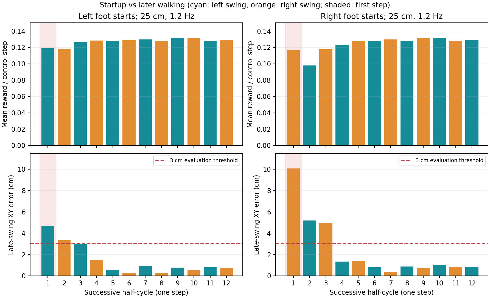

# 首次迈步低奖励诊断

用户确认“第一步”指从静止开始的第一次实际迈步，即第一个摆动半周期。本次只增加诊断记录并执行推理，没有修改训练奖励、reset、命令或模型权重。

## 实验

- checkpoint：`logs/walk/2026-11-01_16-14-59_walk_recovery/training/00002_recovery/model_interrupted.pt`，SHA见 `metadata.json`。
- 固定25cm、左右等频1.2Hz、seed42；分别左先摆和右先摆，各16环境、250控制步（5秒）。
- 无观测/质量/摩擦/推力扰动，沿用checkpoint任务配置；起步无warmup，root默认静止，摆动相位从0或0.5立即推进。
- 分项、接触和XY误差取环境0，其余环境执行同样确定性命令；完整分项见 `left.jsonl`、`right.jsonl`。后续同脚取第5、7、9、11次实际迈步的平均（zero-based半周期4、6、8、10）。这不是多seed稳健性评估。

| 起步方式 | 首步内平均 reward/控制步 | 后续同脚平均 | 首步末期XY误差 | 后续同脚末期XY误差 | 首步归一化质量（非episode回报） |
|---|---:|---:|---:|---:|---:|
| 左脚先摆 | 0.11909 | 0.12931 | 4.684cm | 0.752cm | 0.8950 |
| 右脚先摆 | 0.11653 | 0.12917 | 10.078cm | 0.832cm | 0.8757 |

两个试验均无跌倒、无超时reset；phase对齐与reward重算误差均0。整个首步的reward均值比后续同脚低约8%/10%，并未整步接近0；但首步落点超出3cm评估阈值，右先摆更明显。此前全程约1.7cm的平均误差掩盖了少数起步帧的大误差。



## 为什么会低

### 1. 奖励在每个半周期内都随相位变化

两种起步的半周期局部相位都从 `u=0` 开始，摆动XY权重乘 `u²`；抬脚项仅在 `u∈[0.3,0.7]` 生效。理想状态起始瞬间参考上界约0.09/控制步，中摆动相位 `u=0.5` 的上界约0.18。因此原始奖励在起始段低于中段是设计结果，但它不能独自解释首步落点比后续差。

首步中实测：左先摆早段（u<0.3）均值0.07646，中段（0.3≤u≤0.7）0.16592；右先摆分别0.08420和0.16442。相位之间不能直接拿原始分数比较优劣。

### 2. 起步落点确实比后续弱，而抬脚窗口已得到执行

1.2Hz每侧摆动约0.417秒。reset时root速度为0，直接开始25cm目标，没有独立的站立/重心转移准备阶段。首步根部平均前进速度按位置差分约0.21/0.25m/s；后续相同时间段约0.61m/s，接近命令名义0.60m/s。

首步最高抬脚3.22/3.40cm，窗口内8/8帧都无摆动脚接触，抬脚分项均值0.02932/0.02964；后续同脚约0.03176/0.03155。起步主要差异是落点跟踪：tracking分项首步0.05288/0.05399，后续同脚0.06159/0.06118。右先摆的第二步（左脚）也有5.19cm末期误差和0.09786的平均reward，说明过渡影响会延续到前几步。

“静止→周期步态的过渡能力弱于已进入步态后的跟踪”是这些数据支持的解释；还没有通过改变warmup等单因素消融确定最有效的改进方法。每10秒episode只有一次首步，也使总体均值容易淡化这一短板；这是采样占比事实，不代表PPO完全没有训练起步。

### 3. 左先摆第一控制帧额外触发支撑门控

左先摆第一个20ms控制步：指定支撑脚（右脚）接触力0N，摆动脚（左脚）约846N；tracking被门控为0，reward=0.03449。第二控制步支撑力约264N，reward恢复到0.0757。这是接触/负重建立时的瞬态，不能把这一个控制帧当作整个首步。

右先摆第一控制步指定支撑力约867N，tracking正常，reward=0.08555，接近此时0.09的参考上界。两种起步不能统一归因于支撑门控。初始足底几何与负重瞬态是否还可优化，需另测reset时的足底姿态及接触建立过程。

动作变化惩罚首步均值约−1e−5/控制步，贡献很小；本次没有发现相位/奖励错位。防跳门控沿用训练配置，第一步单独计入诊断。

## 后续应关注的指标

首步与后续应分开验收：左起步首步成功率、右起步首步成功率、首步末期XY误差，以及进入周期步态所需步数。当前这一固定点的两种首步落点都不合格，不能凭全程平均奖励/误差宣称起步已经稳定跟踪。

后续可对“站立→首步→连续行走”的过渡单独优化，例如准备阶段、首步目标渐变或增加短episode采样比例；需先做消融，验证首步与稳态都受益。本次未应用这些训练改动，也未启动训练。

## 代码与复查

唯一运行代码修改：`scripts/preflight_signals.py` 增加可选 `--trace-reward-terms`。默认关闭，仅在本地JSONL增加奖励分项、本步相位、落点误差、接触力及机身竖直速度，不更改观测、动作或云端曲线。编译通过，单文件Pyright 0错误/0警告；两次短回放验证时序对齐误差为0。

两条精确命令见 `commands.json`。例如复查右先摆（不训练）：

```bash
cd /mnt/sage_data/workspace/KUAVO_S54_Newton
uv run --project /mnt/sage_data/workspace/IsaacLab_3_0 --no-sync \
  isaaclab -p scripts/preflight_signals.py --stage straight --mode policy \
  --checkpoint logs/walk/2026-11-01_16-14-59_walk_recovery/training/00002_recovery/model_interrupted.pt \
  --num_envs 16 --steps 250 --seed 42 --initial-swing-side right \
  --step_length_range 0.25 0.25 --gait-frequency 1.2 --trace-reward-terms \
  --viz none --output /tmp/s54_startup_right.json
```

该诊断JSONL的 `reward_components_env0` 是乘dt后的贡献，`reward`是环境均值、`reward_env0`是环境0；`phase_before`用于本步奖励，`phase`是step结束后的相位，reset帧会单独标记。全量明细见 `half_cycle_summary.json`、`startup_summary.json` 和 `metadata.json`。
