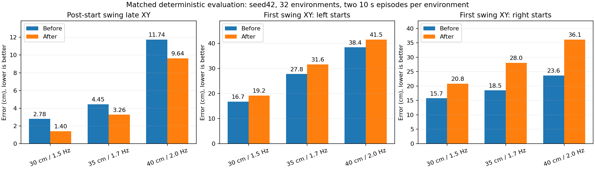
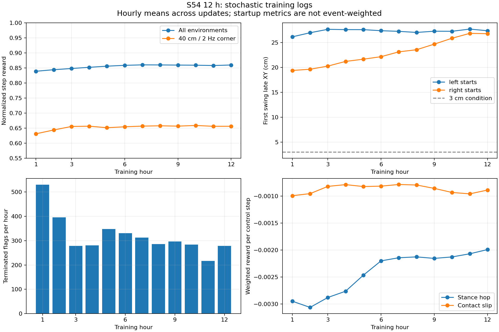
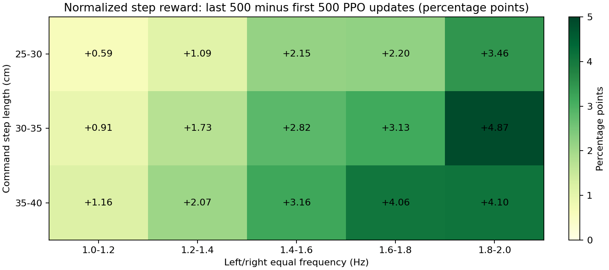

# S54首步XY倍率2.0：12小时训练结果

**结论：你的可视化观察有数据支持，进步主要体现在连续步行跟踪和更少的跳动/滑动。30cm、1.5Hz已表现较成熟；35cm、1.7Hz有改善；40cm、2Hz仍有明显跟踪缺口。首步问题没有解决，三点评估中首步误差均变大。**

实验：`logs/walk/2026-11-02_01-27-46_walk_retention_firstxy2_12h`。
对照起点：上一轮半小时的`2026-11-02_00-32-11_walk_retention_30m/training/00000_retention/model_interrupted.pt`。本轮训练只把`first_swing_xy_multiplier`从1.5调为2.0，同时继续12小时；没有“1.5同样再训12小时”的对照，不能单独归因于倍率改变。

## 训练完成情况

| 项目 | 实际结果 |
|---|---:|
| 运行时间（Asia/Shanghai） | 2026-11-02 01:27:46—约13:27:50 |
| 墙钟时长 | 12.0012h |
| PPO采样+学习 | 11.46h，占墙钟95.49% |
| 新增PPO更新 | 13,333 |
| 已记录transition | 1,747,582,976（约17.48亿） |
| 并行环境 / rollout | 2048 / 64 |
| 有效学习率 | 2e-5 fixed |
| episode / 观测 / 动作 | 10s / 105D / 27D |
| 15格覆盖 | 13,333次rollout全部完整；缺样0；每格每次至少2624条 |
| 训练中eval | 0次，未占用训练时间 |
| terminated / truncated | 3,840 / 3,491,572（分别统计标记） |
| 非有限数日志 | 0 |
| 结束状态 | budget_exhausted，正常到时保存 |
| SwanLab | Upload complete: 406276 records |

[SwanLab实验](https://swanlab.cn/@yagami_light/S54-Locomotion/runs/4p56xi7u)。

最终模型：

```text
/mnt/sage_data/workspace/KUAVO_S54_Newton/logs/walk/2026-11-02_01-27-46_walk_retention_firstxy2_12h/training/00000_retention/model_interrupted.pt
```

`model_interrupted.pt`来自墙钟截止的保存，已成功加载进行确定性评估。SHA-256：`23afc74ecd1e402a0d55a83306adeb22f62f9d2c69ed57c45ce22b9350c55b45`。最终模型未与本轮全部中间checkpoint逐一比较，因此不自动标为最佳。

## 同条件确定性对照：实际进步在哪里

训练结束后另行执行6次短测：起点/最终各3个固定工况，seed42、32环境、1000控制步、随机左右起步、无噪声或物理扰动、episode10秒。每个环境经历两段10秒episode，**不等于连续20秒不复位**。两模型评估统一采用首步倍率2.0，其余配置一致；主要比较物理指标。频率沿用完整左右周期Hz定义，2Hz对应每秒4次交替半步。

每个工况、每个模型均terminated=0、truncated=64，未跌倒环境比例100%。该短测仅支持本仿真、单seed和这些固定点。

### 连续行走跟踪

下表XY取摆动末段local phase≥0.8，排除每次reset后的首个半周期；“成功”还要求中段离地、末段接触且误差<3cm、维持支撑。完成半周期成功率不能单独代替所有轨迹存活率。

| 工况 | 起步后末段XY（前→后） | 误差下降 | 半周期成功率左脚（前→后） | 半周期成功率右脚（前→后） | 新模型连续8半步成功比例 |
|---|---:|---:|---:|---:|---:|
| 30cm / 1.5Hz | 2.78→1.40cm | 49.7% | 86.1%→93.1% | 52.6%→93.2% | 100% |
| 35cm / 1.7Hz | 4.45→3.26cm | 26.6% | 25.6%→45.2% | 53.6%→63.6% | 0% |
| 40cm / 2.0Hz | 11.74→9.64cm | 17.9% | 0.0%→0.0% | 25.5%→15.3% | 0% |

30cm/1.5Hz下，按左脚先迈和右脚先迈分别统计，新模型两脚半周期成功率均约93%，两种起步方式之后的连续步行更均衡。35cm/1.7Hz仍未达到双脚80%的判据。角点左脚成功率仍为0，右脚从25.5%降至15.3%；即使平均XY变小，也没有掌握角点精确交替落脚。

### 更稳、更少跳动：可视化改善的另一来源

| 工况 | 双脚腾空占比（前→后） | 支撑脚跳动占比（前→后） | 接地脚滑动速度（前→后） | 参考方向实际前进速度（前→后） | 新模型 / 名义速度 |
|---|---:|---:|---:|---:|---:|
| 30cm / 1.5Hz | 0.000%→0.000% | 0.000%→0.000% | 0.042→0.036m/s | 0.880→0.881m/s | 0.881 / 0.900m/s |
| 35cm / 1.7Hz | 1.068%→0.488% | 1.332%→0.609% | 0.061→0.056m/s | 1.015→1.049m/s | 1.049 / 1.190m/s |
| 40cm / 2.0Hz | 0.714%→0.072% | 0.898%→0.242% | 0.083→0.070m/s | 1.086→1.173m/s | 1.173 / 1.600m/s |

角点双脚腾空约减少90%、支撑脚跳动约减少73%、接地滑动速度约减少16%，实际前进速度约提高8%。这些物理变化能够解释肉眼看到步态更连贯、更像正常行走。角点实际前进速度约1.173m/s，仍低于参数推算的1.6m/s；不能把目标0.40m当成已实现的真实每步位移。

最终模型三点的最大参考朝向误差约7.0°/8.1°/8.6°，均小于10°；相比起点约5.0°/5.1°/6.3°有所增加，方向跟随没有随其余指标一起改善。

### 首步：本轮未达到原先预期

每个工况、每模型都有64个首步样本：左脚先迈25个、右脚先迈39个。三点前后模型首步综合成功率均为0。

| 工况 | 左脚先迈首步末段XY（前→后） | 右脚先迈首步末段XY（前→后） |
|---|---:|---:|
| 30cm / 1.5Hz | 16.7→19.2cm | 15.7→20.8cm |
| 35cm / 1.7Hz | 27.8→31.6cm | 18.5→28.0cm |
| 40cm / 2.0Hz | 38.4→41.5cm | 23.6→36.1cm |

因此，**“连续走得更好了”成立，“首步倍率2.0已经改善起步”不成立。** 首步成功率0表示严格的离地、支撑和3cm落点条件没有同时满足，不是说机器人从未起步。大误差也得到物理XY指标支持，不应当只用奖励均值解释掉。



## 训练曲线：前500与后500更新

以下为同一12小时run内部比较，避免跨奖励版本直接比较总分。首步和episode日志的简单均值按PPO更新统计，缺事件数时不当作精确的全体事件加权结果。

| 指标 | 前500 → 后500 |
|---|---:|
| 每步归一化奖励 | 0.8374 → 0.8612 |
| 每控制步总奖励 | 0.12532 → 0.12918 |
| 角点每步归一化奖励 | 0.6242 → 0.6587 |
| 平均episode控制步 | 493.9 → 499.4 |
| value loss | 0.0343 → 0.0160 |
| 平均heading绝对误差rad | 0.0636 → 0.0933 |
| 接地滑动惩罚（每步） | -0.000980 → -0.000874 |
| 支撑跳动惩罚（每步） | -0.002978 → -0.002039 |
| 动作分布平均std | 3.291 → 3.664 |

Episode normalized_return按结束标记近似加权后约0.839→0.865；该值不是步行成功率。terminated/truncated可能重叠，未导出重叠计数，不据此计算精确episode生存成功率。

全部15格和基础组/固定角点的归一化奖励均提高，提升更明显的包括30–35cm、1.8–2Hz（+4.87个百分点）和35–40cm、1.6–1.8Hz（+4.06个百分点）。约第6小时后全局回报进入平台，后半程首步尤其右侧误差持续变大。后6小时并没有带来与前半程同等明显的综合收益。

动作mean_std从约3.29增至3.66，是多关节聚合量，不等于所有关节同样剧烈探索。不能仅凭该均值下结论；需要时应核对逐关节std和裁剪率。





## 建议

1. 保留最终模型作为**30cm/1.5Hz连续步行的明确进步基线**，同时保留原始与中间checkpoint；尚未评选整个训练过程的最佳模型。
2. 下一轮优先专项诊断首步：按左右起步、工况记录未离地/未踩准/支撑失败的原因，再比较起步准备或首半周期节奏课程。继续维持10s连续episode与角点回放，先做30–60分钟验证；不单纯继续增加首步XY倍率。
3. 对35–40cm高频区间，补充逐脚末段XY和实际动作/PD饱和测量，判断控制权限与奖励取舍；当前角点左脚成功率0，暂不扩大最大命令。
4. 若希望选更均衡的模型，可对约4–6小时中间checkpoint做同条件短测，比较起步、角点和普通工况，确认后再决定继续长训。本次结论不覆盖未测试的随机种子、持续长episode、外部推扰、停止/转向命令或实机。

本次仅分析日志、执行训练后评估和保存报告，训练配置/环境/奖励未修改，未启动续训。

证据：`training_summary.json`（首尾500、逐小时和全程统计）、`training_curves.jsonl`、`eval_profile.json`、`eval_commands.json`、`eval_progress.log`、六份`before_*.json` / `after_*.json`及日志、`eval_comparison.json`、`summary.json`。评估可按`eval_commands.json`逐条复现；`run_evals.py`为这次评估的顺序执行器。
